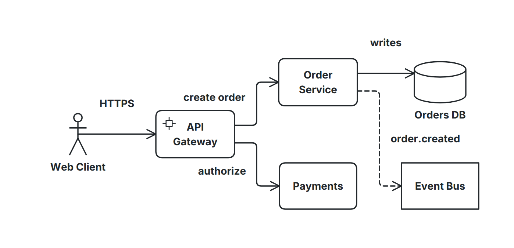
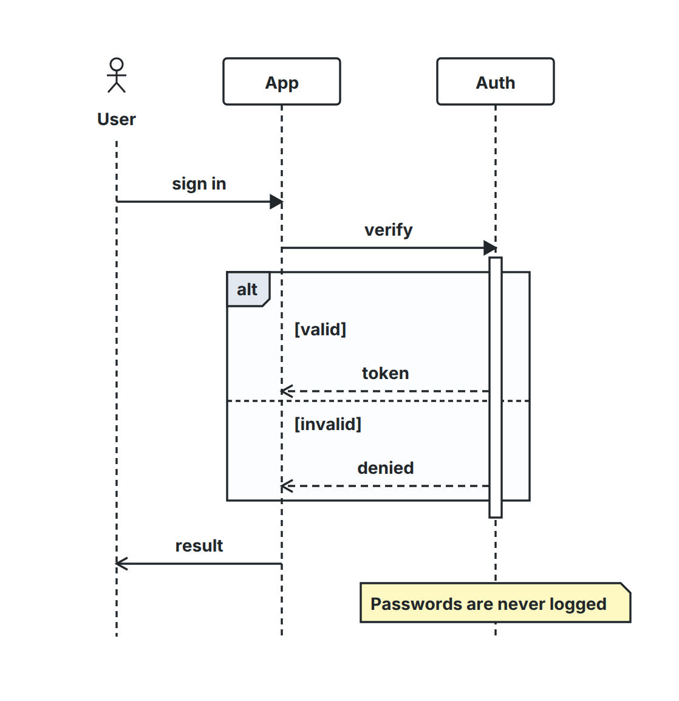

# Coral

[](https://coreyt.github.io/coral/)
[](https://www.npmjs.com/package/@coral-viz/browser)
[](LICENSE)
[](https://github.com/coreyt/coral/actions/workflows/ci.yml)

Coral is a local-first diagram editor and open-source diagramming toolkit for
building precise diagrams from text and direct canvas actions. Author diagrams
in Coral DSL, refine geometry interactively on the canvas, and export clean
vector output without creating an account.

**[Try the live web editor](https://coreyt.github.io/coral/)** — runs directly
in your browser with ten built-in diagram notations, editable examples, and
deterministic SVG/PNG export.

## Visual examples

### Architecture diagram



```coral
@diagram architecture
client actor as "Web Client"
api service [variant: "api"] as "API Gateway"
orders service as "Order Service"
payments service as "Payments"
db database as "Orders DB"
events queue as "Event Bus"

client -> api [sync] as "HTTPS"
api -> orders [sync] as "create order"
api -> payments [sync] as "authorize"
orders -> db [data] as "writes"
orders -> events [async] as "order.created"
```

### UML sequence diagram



```coral
@diagram uml-sequence
user actor as "User"
app participant as "App"
auth participant as "Auth"
signIn = user -#> app [sync] as "sign in"
verify = app -#> auth [sync] as "verify"
work = activation auth {
  choice = alt "valid" {
    granted = auth -.-> app [return] as "token"
  } else "invalid" {
    denied = auth -.-> app [return] as "denied"
  }
}
notify = app -> user [async] as "result"
note "Passwords are never logged" on auth
```

## Quick start

Render Coral diagrams in any web page with no React or editor dependency:

```sh
npm install @graph-ir/core @coral-viz/browser
```

```javascript
import { renderTo } from '@coral-viz/browser';

const source = `@diagram architecture
api_gateway service as "API Gateway"
orders database as "Orders"
api_gateway -> orders as "writes"`;

await renderTo('#diagram', source, { style: 'hifi', theme: 'light' });
```

Other published npm packages for Node.js, React, AI tooling, and syntax
highlighting:

- **Parse, print, and render in Node.js:**
  `npm install @graph-ir/core @coral-viz/language @coral-viz/render`
- **Embed the React editor:**
  `npm install @graph-ir/core @coral-viz/language @coral-viz/render @coral-viz/viz @xyflow/react react react-dom`
- **Connect AI clients via MCP:**
  `npm install @graph-ir/core @coral-viz/language @coral-viz/render @coral-viz/mcp-server`
- **Tree-sitter grammar:**
  `npm install tree-sitter-coral tree-sitter@0.25.1`

## Choose your path

- [Use Coral](docs/use/index.md) to create, edit, convert, and export diagrams
  in the online editor.
- [Embed Coral](docs/embed/index.md) to choose packages and run verified
  library, browser, React, MCP, and Tree-sitter examples.
- [Contribute to Coral](docs/contribute/index.md) to set up a checkout, run
  tests, maintain generated assets, and follow release procedures.

## Compatibility and language contract

- **Web application:** the [hosted editor](https://coreyt.github.io/coral/) is
  online-hosted without installation, an offline shell, or a downloadable
  application archive.
- **Source editions:** Coral 0.2.12 defaults to source edition `0.2.8`;
  document-local custom symbols explicitly select `0.2.9`.
- **Language specification:** the
  [Language 1.3.0 reference](docs/embed/reference/language-specification-1.3.0.md)
  and [evolution policy](docs/contribute/reference/language-evolution.md)
  define the language contract independently of package versions.
- **Examples:** browse editable diagrams in the
  [shared catalog guide](docs/use/how-to/start-from-an-example.md).

## Develop

See [CONTRIBUTING.md](CONTRIBUTING.md) and the
[contributor setup guide](docs/contribute/get-started.md) for toolchain
requirements and local verification commands.

Licensed under [Apache-2.0](LICENSE).
