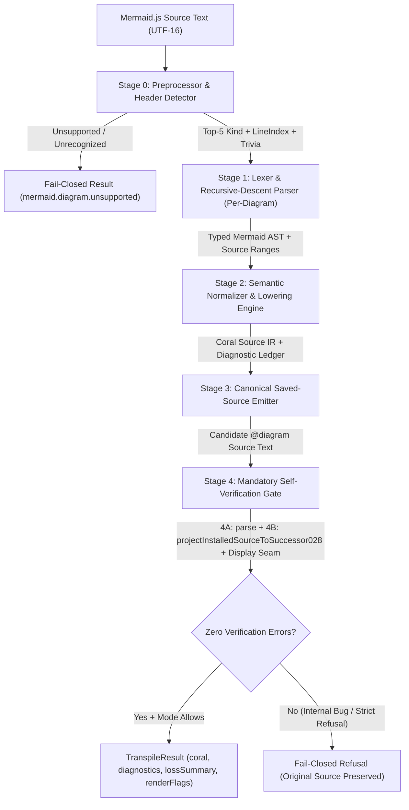

# Mermaid.js-to-Coral Transpiler Architecture Design

> **Revision:** FIX-2 + Edition `0.2.17` Visual UML State update
> (`stateTargetEdition: '0.2.17'` default; `'0.2.8'` retained as explicit
> opt-in; see `../uml-state-visual-support.md`).
> **Companion Documents:**
> - [01-mermaid-coral-taxonomy-and-nomenclature.md](./01-mermaid-coral-taxonomy-and-nomenclature.md)
> - [03-personas-needs-requirements-and-specs.md](./03-personas-needs-requirements-and-specs.md)
> - [04-adversarial-review-and-fix-log.md](./04-adversarial-review-and-fix-log.md)
>
> **Design Authority Constraints:**
> - **100% Deterministic, Zero-LLM:** Never invokes `useLlmChat` or any model
>   provider.
> - **Saved-Source First:** Emits canonical **Coral Edition `0.2.14`** saved
>   source (`@diagram <type>` + `@coralVersion "0.2.14"`) for Flowchart,
>   Sequence, Class, and ER, and **Edition `0.2.8`** (`@diagram uml-state`, no
>   `@coralVersion`) for Tier 1 State—never headerless or `@graph` interchange
>   text.
> - **One Shared Mechanism:** Owned by `@coral-viz/language` (pure
>   transpilation) and `@coral-viz/render` (catalog + successor projection +
>   visual/character display verification seam); consumed uniformly by
>   `@coral-viz/diagram-editor`, `@coral-viz/mcp-server`, and Node/CLI batch
>   callers.
> - **Fail-Closed & Honest Loss Accounting:** Every dropped, degraded,
>   normalized, or unsupported construct emits a stable, UTF-16-positioned
>   diagnostic; unverified or invalid output is never returned.

---

## 1. Why Not Reuse `parseMermaid → GraphIR 3 → printInstalledSource028`?

An audit of Coral `release/0.2.16` proves that extending the existing GraphIR 3
importer-to-writer path is architecturally blocked on five separate invariants:

| Existing Component | Blocking Limitation Observed in `release/0.2.16` |
| --- | --- |
| `packages/language/src/formats/mermaid.ts` | Whole-line regex parsers lose Mermaid source structure: `parseFlowchart` maps shapes to architecture words (`service`, `module`, `database`, `actor`) rather than `flowchart` symbols and ignores `@{...}`, `&` fan-out, `classDef`/`style`, and YAML frontmatter; `parseER` dumps attributes as raw strings and maps entities to `type: "database"` with zero diagnostics; `parseState` flattens composites into `type: "module"`. |
| `packages/language/src/formats/mermaidSequence.ts` | Intentionally locked to the narrow 0.2.6 subset (rejects nested fragments, `par`, `critical`, `break`, `rect`, `box`, `create`/`destroy`, mid-timeline notes, and activations in `writeSupplementalMermaidSequence028`). |
| `packages/render/src/installedSourceWriter028.ts` | Hard-coded to Edition `0.2.8` (`WRITABLE_PROFILES` omits `erd` and `uml-state`), explicitly refuses grouped nodes (`group-source-required`), and rejects all Edition `0.2.14` fields (`style`, `technology`, `description`, `columns`, Crow's Foot connectors, `firstLabel`/`secondLabel`, `-/#/~` UML attributes). |
| `packages/mcp-server/src/tools/convert.ts` | Only handles bounded `uml-sequence` and returns `mcp.coral028.writer.unavailable` for every other Mermaid diagram type. |
| Semantic Loss in GraphIR 3 | Routing Mermaid syntax through GraphIR 3 strips Mermaid scoping, subgraph hierarchy, `classDef` inheritance, activation nesting boundaries, and ER column metadata before emission starts. |

**Architectural Decision:** Introduce a **dedicated, direct 5-stage
Mermaid-to-Coral Source Transpiler** (`Mermaid Text → Mermaid AST → Coral Source
IR → Coral Saved-Source Text → Mandatory Self-Verification`). Legacy
`parseMermaid` remains backward-compatible for `to: "json"` (GraphIR 3 preview)
consumers during 0.2.x, while all `to: "coral"` paths delegate to the shared
transpiler.

---

## 2. High-Level Pipeline Architecture



### Package Ownership & Dependency Boundary

Coral enforces strict one-way package dependencies (`dev/ARCHITECTURE.md`):

- **`@coral-viz/language`** (Zero DOM, Zero React, Zero ELK):
  - `src/detect.ts` *(Updated)* — Recognize all 30 Mermaid.js diagram headers,
    bare `graph` on its own line, and multiline `%%{...}%%` directives before
    `format: 'coral'` fallback.
  - `src/parser/candidate028.ts:1558` *(Prerequisite Bugfix)* — Add
    `'inheritance'` to `KNOWN_RELATIONS_0214['uml-class']` so `[inheritance]`
    aligns with `uml.ts:15` and `umlClass028.ts:14` without emitting
    `coral.relation.unknown`.
  - `src/transpile/mermaid/preprocess.ts` — Stage 0 (UTF-16 `LineIndex`, YAML
    frontmatter, single/multi-line `%%{init}%%`, `accTitle`/`accDescr`, header
    detection).
  - `src/transpile/mermaid/lexer.ts` — Linear-time scanner primitives (zero
    backtracking regexes).
  - `src/transpile/mermaid/parsers/{flowchart,sequence,class,er,state}.ts` —
    Stage 1 typed AST parsers.
  - `src/transpile/mermaid/lower/{ids,colors,styles,flowchart,sequence,class,er,state}.ts`
    — Stage 2 semantic lowering to `CoralSourceIr`.
  - `src/transpile/mermaid/emit.ts` — Stage 3 canonical Coral emitter.
  - `src/transpile/mermaid/index.ts` — Public pure API
    `transpileMermaidToCoral(source, options)` with built-in Stage 4A
    syntax/header parse-back using `parse(coral, builtInRuntime)`.
- **`@coral-viz/render`** (Depends on `@coral-viz/language` + `@graph-ir/core`):
  - `src/transpileMermaid0214.ts` — Public verified API
    `transpileAndVerifyMermaidToCoral(source, options)` running
    `transpileMermaidToCoral` + Stage 4B (`parseInstalledDocument028` →
    `projectInstalledSourceToSuccessor028` → `verifyPortableSuccessorSource028`
    → `validateGraphIRSuccessorWithCatalog` → actual display seam check for
    `visualRenderable` and `characterRenderable`).
- **`@coral-viz/mcp-server`**, **`@coral-viz/diagram-editor`**, and **CLI/Node
  consumers**:
  - Call `transpileAndVerifyMermaidToCoral` directly—zero private emitters, zero
    duplicated mapping tables.

---

## 3. Public TypeScript Contract

```ts
export type MermaidTop5Kind = 'flowchart' | 'sequence' | 'class' | 'er' | 'state';

export type FlowchartTargetNotation = 'flowchart' | 'block' | 'architecture';

export type TranspileMode = 'best-effort' | 'strict';

/**
 * 'visual-safe' (default): degrades Coral edge strokeWeight/strokeColor/motion that
 * successorSourceDisplay028.ts:94-102 currently rejects so Editor & coral_render always succeed.
 * 'portable': emits portable Coral 0.2.14 edge styles; Stage 4B sets visualRenderable = false.
 */
export type EdgeStyleMode = 'visual-safe' | 'portable';

export interface MermaidTranspileOptions {
  /** Default: 'best-effort'. */
  mode?: TranspileMode;
  /** Target notation for Mermaid flowcharts. Default: 'flowchart'. */
  flowchartTarget?: FlowchartTargetNotation;
  /** Edge style emission policy. Default: 'visual-safe'. */
  edgeStyleMode?: EdgeStyleMode;
  /** Preserve Mermaid %% comments as Coral // comments where grammatically valid. Default: false. */
  preserveComments?: boolean;
  /** Maximum input size in UTF-16 code units (DoS guard). Default: 524_288 (512 KB). */
  maxInputLength?: number;
  /** Maximum block/subgraph/fragment nesting depth. Default: 32. */
  maxNestingDepth?: number;
}

export interface SourceRange {
  start: { line: number; column: number; offset: number };
  end: { line: number; column: number; offset: number };
}

export interface TranspileDiagnostic {
  severity: 'error' | 'warning' | 'info';
  /** Stable dot-separated code: mermaid.<diagram>.<construct>.<disposition> or coral.* */
  code: string;
  message: string;
  /** Location in the input Mermaid source (1-based line, 0-based UTF-16 column/offset). */
  range?: SourceRange;
  /** Optional raw snippet for human display. */
  source?: string;
}

export interface TranspileLossSummary {
  /** True iff any diagnostic has severity === 'warning' or 'error'. */
  lossy: boolean;
  errorCount: number;
  warningCount: number;
  infoCount: number;
  /** Distinct diagnostic codes grouped with occurrence counts (Object.create(null) built). */
  byCode: Readonly<Record<string, number>>;
}

export interface MermaidTranspileResult {
  /** True iff coral text was emitted, passed Stage 4 verification, and satisfied mode. */
  ok: boolean;
  detectedKind: MermaidTop5Kind | string | null;
  targetNotation: 'flowchart' | 'block' | 'architecture' | 'uml-sequence' | 'uml-class' | 'erd' | 'uml-state' | null;
  /** '0.2.8' for Tier 1 uml-state; '0.2.14' for flowchart/block/architecture/uml-sequence/uml-class/erd; null on refusal. */
  targetEdition: '0.2.8' | '0.2.14' | null;
  /** Present iff ok === true (never returns unverified or malformed Coral). */
  coral?: string;
  /**
   * Deterministic mapping keyed by **canonical qualified Coral ID** (e.g. "backend.api", "LINE_ITEM")
   * to the original Mermaid ID. Contains an entry for EVERY declared node, group, and participant
   * (whether renamed or unchanged) so callers have complete bidirectional traceability.
   */
  idMap: Readonly<Record<string, string>>;
  /** Frozen, source-position-ordered diagnostic list. */
  diagnostics: readonly TranspileDiagnostic[];
  lossSummary: TranspileLossSummary;
  /** True iff Coral's actual visual display seam (successorSourceDisplay028 + assertRenderableInterpretation028) admits the emitted source. */
  visualRenderable: boolean;
  /** For uml-state (and other character-supported types), true iff renderInstalledCharacterPreview028's envelope admits the emitted source. */
  characterRenderable?: boolean;
}
```

---

## 4. Detailed Stage-by-Stage Engineering Design

### Stage 0: Preprocessor, UTF-16 LineIndex, and Header Detection

1. **Input Guard:** Reject inputs exceeding `maxInputLength` (default 512 KB)
   immediately with `mermaid.input.too-large` (`error`). Reject
   empty/whitespace-only inputs with `mermaid.input.empty` (`error`).
2. **Line Ending & Offset Indexing:** Build a `LineIndex` over the original
   UTF-16 string (`\r\n` and `\n` as single breaks) **before** stripping any
   prefix, guaranteeing accurate 1-based line and 0-based UTF-16 column/offset
   ranges.
3. **YAML Frontmatter (`--- ... ---`):** Linearly scan closing `---` if first
   non-blank line is `---`; parse flat/nested `title` and `config` keys safely
   without `eval`; emit `mermaid.frontmatter.title.dropped` (`info`) /
   `mermaid.frontmatter.config.dropped` (`warning`).
4. **Directives & Accessibility:**
   - Detect single- AND multi-line `%%{init: ...}%%` blocks (scanning to closing
     `}%%`), emitting `mermaid.directive.init.dropped` (`warning`).
   - Consume `accTitle: ...`, `accDescr: ...`, and multiline `accDescr { ... }`,
     emitting `mermaid.accessibility.dropped` (`info`).
5. **Diagram Header Classification (synchronized with
   `packages/language/src/detect.ts`):**
   - Top 5 (supported): `^(flowchart|graph)(?:\s+(TB|TD|BT|LR|RL))?\s*;?$` |
     `^sequenceDiagram\s*;?$` | `^classDiagram(?:-v2)?\s*;?$` |
     `^erDiagram\s*;?$` | `^stateDiagram(?:-v2)?\s*;?$`
   - All 25 other open-source Mermaid.js diagram types (including `radar-beta`,
     `treemap`, `treemap-beta`, `venn-beta`, `ishikawa`, `ishikawa-beta`,
     `wardley-beta`, `zenuml`, `usecase`, `usecase-beta`, `eventmodeling`,
     `treeView-beta`, `cynefin-beta`, `block`, `packet`, `sankey`, `xychart`):
     fail closed with `mermaid.diagram.unsupported` (`error`), naming the
     detected type and supported Top-5 list.
   - Unknown header: fail closed with `mermaid.diagram.unrecognized` (`error`).

---

### Stage 1: Linear-Time Lexer & Typed Recursive-Descent Parsers

**Zero Backtracking Regexes:** All lexing uses deterministic
character-by-character state machines (matching `candidate028.ts`) with explicit
modes for quotes, multiline Markdown strings `` "`...`" ``, brackets, `@{...}`
property maps, and longest-first operators. Guarantees $O(n)$ time and
eliminates ReDoS.

1. **Flowchart Parser (`parsers/flowchart.ts`):**
   - Separates statements on newline and `;` outside quotes, brackets, and
     multiline `` "`...`" `` strings.
   - Node tokenization: bare/quoted ID + longest-first classic shape delimiters
     (`(((`, `((`, `([`, `[(`, `[[`, `[/`, `[\`, `{{`, `{`, `(`, `[`, `>`) OR
     `@{ ... }` block + optional `:::className`.
   - Edge tokenization: **between source node and operator**, recognize optional
     `<edgeId>@` prefix (`A e1@--> B`), longest-first connectors (`<-.->`,
     `<==>`, `<-->`, `o-.-o`, `o--o`, `x--x`, `-.-o`, `==o`, `--o`, `-.-x`,
     `==x`, `--x`, `-.->`, `-..->`, `==>`, `-->`, `--->`, `-.-`, `===`, `---`,
     `~~~`), both `-->|label|` and inline `-- label -->` / `-- label ---` / `-.
     label .->` / `-. label .-` / `== label ==>` / `== label ===`, chains (`A
     --> B --> C`), `&` fan-in/fan-out (`A & B --> C & D`), and standalone `e1@{
     animate: true | animation: fast|slow }`.
   - Subgraphs: recursive `subgraph id [Title]`, `subgraph id`, `subgraph
     "Title"`, and bare `subgraph Multi Word Title` up to `maxNestingDepth`,
     plus nested `direction`.
   - Styling: `classDef`, `class`, `style`, `linkStyle 0,1,...` / `linkStyle
     default`, `click`.
2. **Sequence Parser (`parsers/sequence.ts`):**
   - `;` splitting respecting `#name;` / `#NNN;` entities; `participant`/`actor`
     (with aliases and v11 `@{ "type": ... }`), unquoted multi-word implicit
     participants (`Alice->>Bob Smith: hi`), `create`, `destroy`, `box
     [color|transparent] [label] ... end`.
   - Longest-first arrows: `<<-->>`, `<<->>`, `--|>`, `-|>`, `--|)`, `-|)`,
     `-->>`, `->>`, `--)`, `-)`, `--x`, `-x`, `-->`, `->` + optional `+`/`-`
     activation suffix.
   - Recursive blocks (`alt`/`else`, `opt`, `loop`, `par`/`and`,
     `critical`/`option`, `break`, `rect`), `activate`/`deactivate`, `Note left
     of|right of|over`, `wrap:`/`nowrap:` stripping, `autonumber`,
     `link`/`links`/`properties`/`details`.
3. **Class Parser (`parsers/class.ts`):**
   - `direction`, `class Id["Alias"]`, `` class `My Class` ``, `class Id~T~` /
     `Map~K, V~`, standalone `<<stereotype>> Id`, inline `Id : member`,
     `namespace Ns { ... }`, relationships (including `<..>`, `<|--|>`, `*--*`,
     `o--o`, `()--`, generic endpoints `List~Order~ --|> Collection~Order~`)
     with optional quoted multiplicities and labels, `note "..."` / `note for Id
     "..."`, `style`, `cssClass`, `link`, `callback`.
4. **ER Parser (`parsers/er.ts`):**
   - `direction`, bare/hyphenated/quoted/aliased entities, empty entity blocks
     (`ENTITY {}`), attribute lines `<type> <name> [PK|FK|UK[, ...]]
     ["comment"]` (including `string[]`, `List~int~`, hyphenated names/types),
     Crow's Foot relationships with symbolic markers AND real Mermaid English
     aliases (`only one`, `zero or one`, `one or zero`, `one or more`, `one or
     many`, `zero or more`, `zero or many`, `many`, `1`, `0+`, `1+`) across
     `--`/`to` and `..`/`optionally to`, quoted/unquoted/empty `: ` labels, and
     `style`/`classDef`/`class`.
5. **State Parser (`parsers/state.ts`):**
   - `direction`, `state "Label" as id`, recursive `state id { ... }`, `--`
     concurrency separators, `state id <<choice|fork|join>>`, single or multiple
     `id : description` lines, transitions `src --> dst [: label]` (including
     multiple `[*]` transitions and self-transitions), single-line and multiline
     `note left|right of ... [end note]`, `classDef`/`class`/`style`/`:::`.

**Partial Recovery Rule:** Malformed statements record located
`mermaid.<diagram>.statement.unparsed` errors and synchronize to the next
statement boundary so all issues surface in one pass.

---

### Stage 2: Semantic Normalization & Lowering Engine (`CoralSourceIr`)

#### A. Deterministic ID Sanitizer, Canonical Reserved-Word Guard & `idMap` (`lower/ids.ts`)
- **Single Canonical Reserved-Word Set (27 words):** `layout`, `route`,
  `constraint`, `arrange`, `group`, `columns`, `attributes`, `operations`,
  `alt`, `else`, `opt`, `loop`, `par`, `and`, `critical`, `break`, `activation`,
  `region`, `participants`, `note`, `as`, `port`, `on`, `at`, `pinned`, `label`,
  `waypoint`.
- **Algorithm:**
  1. If `rawId` matches `^[A-Za-z_][A-Za-z0-9_]*$` and is not reserved and not
     taken in scope, retain verbatim.
  2. Otherwise: replace non-`[A-Za-z0-9_]` runs with `_`, trim trailing `_`,
     prefix `n_` if empty or digit-leading, suffix `_id` if reserved.
  3. **Collision loop:** If candidate `base` is taken in scope, iterate `k = 2,
     3, ...` until `${base}_${k}` is free in scope.
  4. Register **`idMap[qualifiedCoralId] = rawId`** for every declared node,
     group, and participant. When renamed, emit `mermaid.id.normalized` (`info`)
     and preserve `rawId` in `as "<rawId>"` if no explicit display label was
     given.

#### B. CSS Color & Style Normalizer (`lower/colors.ts`, `lower/styles.ts`)
- Expands 3-digit `#RGB` → `#RRGGBB`, maps all 148 standard CSS named colors and
  `rgb(r,g,b)` → `#RRGGBB`, and rejects alpha/unsupported colors (`rgba`,
  `#RRGGBBAA`, `hsl`, `transparent`, `none`) with
  `mermaid.style.color.unsupported` (`warning`).
- Maps `stroke-width` >= 3px → `thick`; maps `stroke-dasharray` → `dashed` ONLY
  when a non-zero dash pattern is specified (ignoring `0` / `none`).
- Applies `classDef` → `class`/`:::` → inline `style` in Mermaid precedence
  order.

#### C. Flowchart Subgraph Scoping & Root-Scope Qualification (`lower/flowchart.ts`)
1. Assign each node its owning `groupPath[]` (first subgraph declaration wins;
   disjoint multi-subgraph declarations hoist to Lowest Common Ancestor with
   `mermaid.flowchart.subgraph.reparented` `warning`).
2. Emit nodes inside their owning `group` blocks using **local** sanitized IDs.
3. Because Stage 3 emits all edges at document root scope, **ALWAYS dot-qualify
   every grouped node endpoint** (`backend.api -> backend.sub`, `check ->
   backend.api`). Bare child IDs at root scope are never emitted
   (`candidate028.ts:1965`).
4. When `flowchartTarget === 'block'` and Mermaid omitted direction (or used
   `TD`/`TB`), emit `layout [direction: DOWN]` explicitly so Coral's `block`
   default (`RIGHT`) does not flip orientation.
5. Emit `[variant: "start"]` on a `flowchart` stadium node ONLY when it is the
   **unique** 0-in-degree stadium node with >=1 outgoing edge (honoring
   `flowchart.ts:159` `max: 1`).

#### D. Sequence Identity, Lifecycle & Container-Scoped Activation Lowering (`lower/sequence.ts`)
1. **Unified Namespace Allocation:** Register all explicit and implicit
   participants FIRST into `usedIdentities: Set<string>`. Allocate synthetic
   message IDs (`msg_1`, `msg_2`, …) and participant-group IDs (`box_1`, …)
   skipping any ID already in `usedIdentities`!
2. **Lifecycle (`create` / `destroy`):**
   - For `create participant W as Worker` / `create actor U as User`: emit
     explicit root participant declaration (`W participant as "Worker"` / `U
     actor as "User"`) to preserve alias and `actor` type
     (`candidate028.ts:2226-2231`), and attach `[create]` to the following
     root-level dashed-open message targeting `W`. If `create` appears inside a
     fragment, drop `[create]` with `warning`
     `mermaid.sequence.create.root-only.dropped`.
   - For `destroy W`: attach `[destroy]` ONLY when the following message is at
     root timeline, has `W` as **receiver**, and `W` has no later
     messages/notes/activations (`successorSourceProjection028.ts:276-286`).
     Otherwise drop `[destroy]` with `warning`
     `mermaid.sequence.destroy.unsupported.dropped`.
3. **Container-Scoped Sibling-Item Activation Tree:**
   - Parse sequence blocks into a lexical container tree (root timeline,
     fragment operands, regions). Each container holds an ordered list of
     sibling items (`message`, `note`, `fragment`, `region`).
   - Resolve `+` (starts activation on target at current message index), `-`
     (ends activation on source at current message index), and imperative
     `activate P` / `deactivate P`:
     - `activate P` anchors to the immediately preceding sibling message iff it
       targeted `P` in the same container; otherwise it anchors to the **next**
       sibling item in the same container (supporting pre-message `activate
       P`!).
     - `deactivate P` anchors to the immediately preceding sibling item in the
       same container.
   - **Validation & Nesting:**
     - Empty activation (zero items) → drop silently with `info`.
     - Unclosed activation at container/EOF → error in `strict`; auto-close at
       last item involving `P` in same container with `warning`
       `mermaid.sequence.activation.unclosed` in `best-effort`.
     - Cross-container activation (`start.container !== end.container`),
       activation wrapping a `[destroy]` targeting `P`, or interleaved
       non-nested spans (`s1 < s2 <= e1 < e2`) → drop the conflicting activation
       wrapper with `warning` `mermaid.sequence.activation.non-nested.dropped`
       (preserving all messages/notes!).
     - Equal spans (`s1 === s2 && e1 === e2`) → deterministic tie-break:
       earlier-opened activation wraps later-opened activation.
   - **Empty Fragment Operands:** If a Mermaid `alt`/`opt`/`loop`/`par` operand
     contains zero items, drop the empty operand (converting 1-remaining-operand
     `alt` to `opt`, or dropping an entirely empty fragment) with `warning`
     `mermaid.sequence.fragment.empty-operand.dropped` so
     `successorSequenceDisplay028.ts:57` never rejects.

#### E. Class Relationship Polarity, Native `group` Namespaces & Compartment Collection (`lower/class.ts`)
1. Collect all classifier declarations, standalone `<<stereotype>>` lines, and
   `Class : member` lines into an ordered classifier map; emit at most one
   `attributes { ... }` and one `operations { ... }` per classifier.
2. Emit Mermaid `namespace Ns { ... }` natively as `Ns group { ... }` (verified
   supported in `uml-class` `0.2.14`) and dot-qualify references
   (`Ns.Triangle`).
3. Normalize relationship polarity cleanly:
   - `Parent <|-- Child` → `Child -|> Parent [inheritance]` *(prerequisite
     `KNOWN_RELATIONS_0214` fix)*
   - `Iface <|.. Impl` → `Impl -.|> Iface [realization]`
   - `Whole *-- Part` / `Part --* Whole` → `Whole -- Part [composition,
     firstEnd: filledDiamond]`
   - `Whole o-- Part` / `Part --o Whole` → `Whole -- Part [aggregation,
     firstEnd: diamond]`
   - `A --> B` / `B <-- A` → `A -> B [association]`
   - `A ..> B` / `B <.. A` → `A -.-> B [dependency]`
   - `A <..> B` → `A <-> B [dependency, style: "dashed"]`
   - Symmetric markers (`<|--|>`, `*--*`, `o--o`) encode the second end in the
     operator suffix (`-|>`, `-#<>`, `-<>`) and the first end in `firstEnd:`.

#### F. ER Column Swapper & Crow's Foot Normalizer (`lower/er.ts`)
1. Sanitize entity IDs (`LINE-ITEM` → `LINE_ITEM entity as "LINE-ITEM"`).
2. Invert `<type> <name> [PK, FK, UK]` → `columns { <name> <type> [pk, fk, uk]
   }`, sanitizing `[]`/`~...~`/hyphens, dropping duplicate column names per
   entity with `mermaid.er.column.duplicate.dropped` (`warning`), and dropping
   trailing column comments with `mermaid.er.column-comment.dropped`
   (`warning`).
3. Translate symbolic and English-alias cardinalities directly to Coral
   `0.2.14`'s native Crow's Foot connectors (`||--o{`, `||..|{`, `}|..o{`,
   etc.).

#### G. State Machine Lowering (`lower/state.ts`)
1. Emit `@diagram uml-state` (Edition `0.2.8`—NO `@coralVersion "0.2.14"`, NO
   `layout`, NO `[description: ...]`) so `characterState028` remains compatible.
2. Allocate one collision-free `start initial` (when any `[*] --> X` exists) and
   one `finish final` (when any `X --> [*]` exists).
3. Concatenate multiple `s1 : desc` lines with `\n`; use as `as "..."` if no
   alias exists, else degrade with `mermaid.state.description.degraded`
   (`warning`).
4. In Tier 1: flatten composite states (`mermaid.state.composite.flattened`),
   degrade `<<choice>>`/`<<fork>>`/`<<join>>`
   (`mermaid.state.pseudostate.degraded`), drop `--` concurrency, `direction`,
   `note`, and `style` with warnings.

---

### Stage 3: Canonical Coral Saved-Source Emitter (`emit.ts`)

Compile-time emitter invariants:
1. **Edition Header:** `@diagram <type>\n@coralVersion "0.2.14"` for
   Flowchart/Sequence/Class/ER; `@diagram uml-state` for Tier 1 State.
2. **Formatting Fixpoint:** 2-space indentation, LF newlines, single blank line
   between header/layout, declarations, participant groups, and edges/timeline
   items so `formatDocument028(coral, runtime) === coral`.
3. **Strict Saved-Source String Escaping:** Emit ONLY `\"`, `\\`, `\n` escapes;
   normalize `\t` → space `' '` and U+2028/U+2029 → `\n` (never emit literal
   `\t` or `\t` escape!).
4. **Connector End Shorthand Invariant (Prevents
   `coral.syntax.connector.end-conflict`):** Whenever
   `connectorEndHasShorthand028(secondEnd, 'second')` is `true`, ALWAYS encode
   `secondEnd` in the connector operator (`-o`, `->`, `-#>`, `-|>`, `-<>`,
   `-#<>`, `-|`, `-{`), NEVER as a `secondEnd:` key on `--`. Never emit
   redundant `secondEnd: none` on `--`.
5. **Double-Dimension & Label Mutual-Exclusion Guards:**
   - NEVER emit `dashed` in `[style: "..."]` when the connector operator is
     dashed (`-.->`, `-.-`, `-.|>`, `-.-o`, `||..o{`, `||-.-|{`).
   - NEVER emit both `[label: "..."]` and `as "..."` on the same
     edge—canonically emit `as "<label>"`.
   - NEVER repeat a style dimension (color, pattern, weight, motion) inside
     `[style: "..."]`.

---

### Stage 4: Mandatory Self-Verification Gate (Corrected for Successor-Only Constructs!)

**Critical Coral `0.2.16` Fact:**
`packages/language/src/parser/document028.ts:30-47` intentionally returns
`graph: undefined` whenever a saved document uses successor-only constructs
(`layout`, edge `style`, sequence `note`/`activation`/`region`/`participants`).
Stage 4 therefore verifies through Coral's **real** two-layer contract:

1. **Stage 4A (`@coral-viz/language` — Pure Syntax & Header Gate):**
   - Build `trustedDigests` directly from `HEADER_MANIFEST_028` and construct
     `HeaderRuntime028` (`currentVersion: '0.2.8'`).
   - Call `parse(coral, runtime)`.
   - **Assert:** `doc.header.header !== undefined`,
     `doc.header.diagnostics.length === 0`, AND `doc.syntax.diagnostics.length
     === 0` (zero errors AND zero internal transpiler-induced warnings such as
     `coral.relation.unknown`!). Do **NOT** assert `doc.graph !== undefined`.
2. **Stage 4B (`@coral-viz/render` — Successor Projection, Catalog & Display
   Seam Gate):**
   - Call `parseInstalledDocument028(coral)` and
     `projectInstalledSourceToSuccessor028(coral)`: assert `projected.graph !==
     undefined` and `projected.diagnostics.length === 0`.
   - Call `verifyPortableSuccessorSource028(coral)` and
     `validateGraphIRSuccessorWithCatalog(...)` (`scope === 'full' && complete
     === true`).
   - **Truthful `visualRenderable` Determination:** Execute the actual visual
     display seam matching Coral's own consumers
     (`packages/diagram-editor/src/parsers.ts:203-214`,
     `packages/mcp-server/src/tools/render.ts:225-229`) inside a capability
     catch:
     - Branch by diagram structure: if `projected.graph.interaction` is present
       (`uml-sequence`), call `const display =
       successorSourceDisplay028(projected.graph)` (because
       `successorSourceDisplayWithSemanticPorts028` intentionally throws `Error`
       on sequence interaction graphs at
       `successorSourceDisplay028.ts:104-109`); for all other notations, call
       `const { display } =
       successorSourceDisplayWithSemanticPorts028(projected.graph)`.
     - Resolve the edition-matched installed catalog snapshot explicitly: `const
       catalog = installedCatalogSnapshotForEdition(targetNotation,
       targetEdition)` (preventing fallback to Edition `0.2.8` when verifying
       Edition `0.2.14` symbols like `block-cylinder`, `erd-weak-entity`, or
       `arch-system-boundary`), then call
       `assertRenderableInterpretation028(display.nodes, targetNotation,
       display.profile, catalog)`.
     - If both succeed → `visualRenderable = true`.
     - If either throws `RenderCapabilityError`
       (`render.capability.character-only-edition` for `uml-state`) or
       `SuccessorDisplayCapabilityError028`
       (`render.capability.edge-rgb|edge-stroke-weight|edge-motion` under
       `edgeStyleMode: 'portable'`) → `visualRenderable = false` + emit matching
       `info` advisory (`coral.uml-state.visual-unavailable` or
       `coral.edge-style.visual-unavailable`).
     - Any unexpected error → **fail closed**
       (`coral.transpile.self-check.failed`).
   - **Truthful `characterRenderable` Determination (for `uml-state`):**
     Delegate directly to Coral's `stateCharacterUsesChain028(display)`
     (`packages/render/src/characterState028.ts:139`) inside `try/catch` (which
     executes `stateGraph(display)` checking exact bounds: **1** `initial` with
     1 outgoing & 0 incoming edge, **1** `final` with >=1 incoming & 0 outgoing
     edge, **1–8** simple states [`nodes.length` in 3..10], **2–20**
     transitions, no self-transitions, and all nodes on an initial-to-final
     path); set `characterRenderable: true | false` and emit
     `coral.uml-state.character-bounds.exceeded` (`info`) when `false`.
3. **Fail-Closed & Strict Mode Gates:**
   - Any unexpected failure in Stage 4A or 4B returns `{ ok: false, coral:
     undefined, diagnostics: [..., { severity: 'error', code:
     'coral.transpile.self-check.failed', ... }] }`.
   - Under `mode: 'strict'`, if any diagnostic has `severity === 'warning' ||
     severity === 'error'`, return `{ ok: false, coral: undefined, ... }` with
     `coral.transpile.strict.refused` (`error`) appended. (`info` diagnostics do
     NOT trigger strict refusal.)

---

## 5. Diagnostic Code Catalog

| Code Pattern | Severity | Meaning |
| --- | :---: | --- |
| `mermaid.input.empty` / `mermaid.input.too-large` / `mermaid.input.nesting-exceeded` | `error` | Empty input, >512 KB, or >32 nesting levels |
| `mermaid.diagram.unrecognized` / `mermaid.diagram.unsupported` | `error` | Unknown header or one of the 25 out-of-scope Mermaid.js types |
| `mermaid.<type>.statement.unparsed` / `block.unclosed` | `error` | Malformed Mermaid syntax or unclosed block |
| `mermaid.text.invalid-scalar` | `error` | Non-XML-1.0 scalar, prohibited C0/C1 control char, or lone surrogate |
| `mermaid.style.color.unsupported` | `warning` | Alpha/HSL/`transparent`/`none` color cannot map to Coral `#RRGGBB` |
| `mermaid.flowchart.shape.degraded` / `marker.cross.degraded` / `edge.invisible.dropped` / `edge-weight.degraded` / `edge-color.degraded` / `edge-animation.degraded` / `subgraph-direction.dropped` / `subgraph.reparented` / `click.dropped` | `warning` | Flowchart construct degraded or dropped in target notation / `visual-safe` mode |
| `mermaid.sequence.participant-type.degraded` / `create.root-only.dropped` / `destroy.unsupported.dropped` / `arrow.degraded` / `arrow.cross.degraded` / `arrow.bidirectional.degraded` / `text-wrap.dropped` / `activation.unclosed` / `activation.non-nested.dropped` / `fragment.empty-operand.dropped` / `critical-option.degraded` / `autonumber.dropped` / `metadata.dropped` | `warning` | Sequence construct degraded or dropped |
| `mermaid.class.enum-literals.dropped` / `modifier.abstract.dropped` / `member-modifier.dropped` / `member-type.sanitized` / `generic.degraded` / `type.defaulted` / `note.dropped` / `link.dropped` | `warning` | Class construct outside Coral `0.2.14` saved source |
| `mermaid.er.column-comment.dropped` / `column-type.sanitized` / `column.duplicate.dropped` | `warning` | ER column comment dropped, type sanitized, or duplicate column dropped |
| `mermaid.state.composite.flattened` / `concurrency.dropped` / `pseudostate.degraded` / `description.degraded` / `direction.dropped` / `note.dropped` / `style.dropped` | `warning` | State construct outside Coral Tier 1 flat `uml-state` |
| `mermaid.directive.init.dropped` / `frontmatter.config.dropped` / `text.markdown.degraded` | `warning` | Theme/init config or markdown formatting degraded |
| `mermaid.id.normalized` / `text.tab.normalized` / `accessibility.dropped` / `frontmatter.title.dropped` / `sequence.box-color.dropped` / `sequence.rect-color.dropped` / `sequence.note-side.degraded` / `sequence.arrow.normalized` / `sequence.create-arrow.normalized` / `sequence.alt-single-branch.normalized` / `class.visibility.defaulted` / `class.stereotype.degraded` / `class.lollipop.degraded` / `state.description.as-label` | `info` | Benign normalization or non-semantic metadata (does NOT fail `strict` mode) |
| `coral.uml-state.visual-unavailable` / `coral.uml-state.character-bounds.exceeded` / `coral.edge-style.visual-unavailable` | `info` | Honest capability advisory from Stage 4B display seam |
| `coral.transpile.strict.refused` / `coral.transpile.self-check.failed` | `error` | Strict refusal or internal Stage 4 fail-closed invariant trap |

---

## 6. Consumer Surface Integration

### 6.1 `@coral-viz/mcp-server` (`coral_convert`)
- Upgrade `handleConvert` (`packages/mcp-server/src/tools/convert.ts`) when
  `sourceFormat === 'mermaid' && to === 'coral'`:
  - Delegate directly to `transpileAndVerifyMermaidToCoral(content, { mode:
    strict ? 'strict' : 'best-effort', flowchartTarget, edgeStyleMode })`.
  - Extend `coral_convert` input schema additively with optional
    `flowchartTarget?: 'flowchart' | 'block' | 'architecture'` (default
    `'flowchart'`) and `edgeStyleMode?: 'visual-safe' | 'portable'` (default
    `'visual-safe'`).
  - **Preserve 100% backward compatibility** in `structuredContent`: retain
    `from`, `to`, `nodeCount`, `edgeCount`, `diagnostics`, and
    `candidateVersion: '4.0.0'`, while additively returning `detectedKind`,
    `targetNotation`, `targetEdition`, `visualRenderable`,
    `characterRenderable`, `lossSummary`, and `idMap`.
  - Document the intentional behavioral upgrade in
    `packages/mcp-server/test/convert.test.ts` (previously-refused sequence
    activations and mid-timeline notes now convert to verified `@diagram
    uml-sequence`!).

### 6.2 `@coral-viz/diagram-editor` (Interactive Editor)
- Explicit **"Convert to Editable Coral"** action (never silently overwrites
  pasted Mermaid; never invokes LLM).
- **Pre-Commit Loss Review:** When `lossSummary.lossy === true`, displays
  grouped diagnostics and actionable one-click target switches (e.g., *"Switch
  to Block"* / *"Switch to Architecture"* when cylinders are present).
- **Single Atomic Undo Step:** Replacing the document and switching format
  commits as one undoable transaction (`Ctrl+Z` restores exact original Mermaid
  bytes).
- **Refusal & `uml-state` Honesty:** Refusal leaves original Mermaid untouched.
  For `uml-state` (`visualRenderable === false`), provides **Copy Coral Source /
  Save `.coral`** alongside an honest notice that visual canvas rendering for
  `uml-state` is pending Phase 2.

### 6.3 CLI / Docs-as-Code Batch Conversion (Closing Gate G5)
- Thin Node/CLI command (`coral convert <input.mmd|dir> --to coral [--strict]
  [--flowchart-target block] [--edge-style-mode visual-safe|portable]`) over
  `transpileAndVerifyMermaidToCoral`, supporting `.mmd` files and fenced
  Markdown ```` ```mermaid ```` blocks with JSON diagnostic reports and CI exit
  codes.

---

## 7. Security, Safety, and Performance Budgets

| Dimension | Engineering Control | Target Budget |
| --- | --- | --- |
| **ReDoS Immunity** | Character-by-character linear lexers; zero nested-quantifier regexes. | Linear $O(n)$ worst-case |
| **Memory & Stack Safety** | Hard caps `maxInputLength` (512 KB) and `maxNestingDepth` (32). | < 64 MB peak heap for 512 KB input |
| **Latency** | Pure synchronous TypeScript (no DOM, no Puppeteer, no Mermaid.js runtime dependency). | <= 15 ms (30 nodes), <= 50 ms (100 nodes), <= 250 ms (500 nodes) |
| **Prototype Pollution** | `Map` / `Set` / `Object.create(null)` for every user-keyed table (`nodeMap`, `classDefs`, `idMap`, `byCode`). | 0 prototype-key vulnerabilities |
| **Injection / XSS / XML Safety** | Enforce XML 1.0 legal scalars; normalize `\t` → space and U+2028/U+2029 → `\n`; escape ONLY `\"`, `\\`, `\n`; keep non-`<br>` HTML tags as literal escaped text. | 0 raw HTML/SVG injection vectors |
| **Determinism** | Zero `Date.now()`, `Math.random()`, or locale-dependent sorting. | 100% byte-identical repeatability |

---

## 8. Prerequisites & Phase-2 Coral Language/Renderer Gap Remediation

### Immediate Prerequisite (Phase 1B — 0.2.16 Maintenance Fix)
- **Fix `KNOWN_RELATIONS_0214['uml-class']`
  (`packages/language/src/parser/candidate028.ts:1558`):** Add `'inheritance'`
  alongside `'generalization'` so `@diagram uml-class` under `@coralVersion
  "0.2.14"` agrees with `uml.ts:15` and `umlClass028.ts:14` and passes
  `projectInstalledSourceToSuccessor028` cleanly.
- **Update `packages/language/src/detect.ts`:** Recognize all 30 Mermaid.js
  diagram headers, bare `graph`, and multiline `%%{...}%%` preambles.

### Phase 2 Coordinated Edition `0.2.17` / `0.3.0` (Preserving Frozen `0.2.8`/`0.2.9`/`0.2.14` Digests)
1. **Promote `uml-state` to Full Visual + Hierarchical Notation:** Ship visual
   state symbols (`state-initial`, `state-simple`, `state-final`,
   `state-composite`, `state-choice`, `state-fork-join`), lift `scene.ts:116`,
   and admit `group` composites + `layout` + `note`.
2. **Enable Visual Edge Styles in `successorSourceDisplay028`:** Render edge
   `strokeColor`, `strokeWeight` (`thick`), and `motion` (`animated:*`) in
   `@coral-viz/render` so `'visual-safe'` and `'portable'` converge cleanly.
3. **Close `uml-class` Saved-Source Gaps:** Admit `enum` `literals { ... }`,
   `abstract`/`static`/`readonly`/`derived` modifiers, and parameterized generic
   types (`List<T>`, `String[]`) in `grammar-028.ebnf`.

---

## 9. Phased Delivery Plan

| Phase | Scope | Exit Gate |
| --- | --- | --- |
| **Phase 1A** | `detect.ts` update, core pipeline (Stages 0–4A/4B), ID/color/style lowerers, **Flowchart** (`flowchart`/`block`/`architecture` targets, `visual-safe`/`portable` edge modes) + **ER** (`@diagram erd` `0.2.14`). | 100% golden & fuzz corpus pass Stage 4A+4B; closes Launch Gate **G5** for E1 flowchart/ER outgrowers. |
| **Phase 1B** | `KNOWN_RELATIONS_0214` `'inheritance'` prerequisite fix, **Sequence** (full `0.2.14` saved-source upgrade preserving `msg_N`), **Class** (`@diagram uml-class` `0.2.14` with native `group` namespaces). | All existing `mermaid-sequence.test.ts` & `convert.test.ts` compatibility cases + new recursive/activation/class suites green. |
| **Phase 1C** | **State** (Tier 1 flat `@diagram uml-state` Edition `0.2.8` + honest `visualRenderable`/`characterRenderable` flags), Editor UI action (atomic Undo + loss review), MCP `coral_convert` upgrade, CLI batch wrapper. | Playwright browser tests + MCP contract tests + ReDoS/performance gates green. |
| **Phase 2** | Edition `0.2.17` visual `uml-state`, visual edge styles, `uml-class` enum/modifier/generic closure; extend transpiler to `architecture-beta`, `C4*`, `block-beta`. | Coordinated catalog digest bump + full SVG visual regression suite. |
