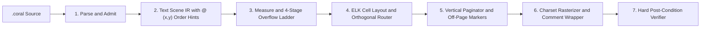

# Coral Plain-Text and ASCII Diagram Renderer Specification

Status: Approved design specification (`2026-11-28`), scheduled for **Coral
`0.2.17`** (the active unreleased release candidate on `dev/0.2.17`). The
legacy `0.2.8` character preview (`renderInstalledCharacterPreview028` and
`renderCharacterGraph028`) is **hard-deprecated and no longer supported**.

Inputs: Owner design interview (`2026-11-28`) and audit of the current `0.2.8`
character preview modules
([characterPreview028.ts](../../packages/render/src/characterPreview028.ts) and
[characterRouted028.ts](../../packages/render/src/characterRouted028.ts)).

## 1. Problem statement and core use cases

Coral currently ships a strictly bounded `0.2.8` character preview
(`renderInstalledCharacterPreview028`) supporting 6 flat diagram subsets at
fixed `40|80|120` column widths, with hard refusals for groups, coordinates,
styles, and the 7 modern notations (`architecture`, `infrastructure`, `erd`,
and others). It cannot render real-world `.coral` systems diagrams, paginate
across printed pages, or produce compact source-code comments.

This specification defines a clean-slate **Plain-Text and ASCII Diagram
Renderer** replacing the legacy `0.2.8` character preview (reusing proven
practices and modules where helpful, with no backward-compatibility obligation
to `renderInstalledCharacterPreview028`), serving two primary real-world
workflows:

1. **Regulated plain-text submissions (`profile: 'document'`):** Fixed-pitch
   `.txt` filings where SVG/PNG is prohibited, yet complex systems must be
   communicated unambiguously within strict **US Letter (`72x55`)** and **A4
   (`72x60`)** page bounds, using pure 7-bit ASCII, mandatory ASCII form-feeds
   (`\f`), non-splitting boxes, and paired off-page continuation markers.
2. **Source-code comment embedding (`profile: 'comment'`):** Readable,
   vertically compact diagrams embedded directly inside code comments (`//`,
   `#`, `--`, `/* */`, `<!-- -->`), defaulting to crisp standard UTF-8
   box-drawing (`utf8-box`), automatic comment-prefix width budgeting, and
   guaranteed closing-delimiter safety.

## 2. Locked design decisions

| Decision area | Agreed choice |
| --- | --- |
| Delivery mode | Approved requirements, architecture, and acceptance spec scheduled for implementation in **Coral `0.2.17`** (unreleased). |
| Legacy compatibility | Legacy `0.2.8` character preview (`renderInstalledCharacterPreview028`, `renderCharacterGraph028`) is **hard-deprecated (no longer supported)** with no backward-compatibility obligation; migrate reusable code/practices (byte verifier, `\u{HEX}` escaping, ELK cell routing, MonoTrue endpoint/role tables, debug view) into a new clean module tree. |
| Phased notation scope | Phase 1 (7 notations): `architecture`, `infrastructure`, `flowchart`, `erd`, `uml-sequence`, `uml-state` (Edition `0.2.17`), `uml-class`. Phase 2 (6 notations): `block`, `bpmn`, `aiml`, `data-engineering`, `code`, `sketch`. |
| Authored intent and visual attributes | Respect authored `@ (x, y)` relative ordering (top-to-bottom / left-to-right rank and in-layer hints). Gracefully ignore pixel geometry, RGB/inline `[style]`, and custom `@symbol` SVG artwork (rendered as labelled boxes) with structured non-fatal notices (opt-in `--strict` to refuse). |
| Document page geometry | Conservative 72 columns for both US Letter (`72x55`) and A4 (`72x60`) (1-inch margins at 10 cpi / 6 lpi), mandatory ASCII form-feed (`\f`, `0x0C`) between pages, strict 7-bit ASCII default (`0x20-0x7E`, LF or CRLF), plus custom `pageWidth x pageHeight` overrides. |
| Multi-page strategy | Vertical-first pagination (auto-reflow layout to fit within 72 columns; never split boxes/compartments across pages) with inline paired off-page markers on severed edges (`[-> p.2:A]` / `[p.1:A ->]`) plus a compact per-page continuation footer listing cross-page edges and labels. |
| Comment profile defaults | Default charset `utf8-box`, picture-only (no `CHAR-PREVIEW/1` or `LEDGER` boilerplate), deduplicated labels (omit redundant `[id]` when labels are unique), compact 3-row boxes/decisions, built-in comment wrappers subtracting prefix width and preventing closing-delimiter collisions. |
| Charset support | Three charsets: `ascii` (strict 7-bit, default for `document`), `utf8-box` (standard Unicode box-drawing, default for `comment`), and `monotrue-v1` (retained opt-in for controlled MonoTrue environments with hash/face/role verification). |
| Overflow policy | Progressive 4-step readability ladder (wrap -> demote secondary metadata to footnote -> key-abbreviate long labels with legend -> fail closed only on indivisible overflow). Zero silent truncation. |
| Product surfaces | Expose everywhere: `@coral-viz/render`, `coral` CLI, `@coral-viz/mcp-server` (`coral_render`), `@coral-viz/diagram-editor` (Export `.txt` and Copy as Comment), and the main `@coral-viz/browser` bundle (816 KiB gzip ceiling). |

## 3. Functional requirements

### 3.1 Profiles and output grammar

#### REQ-TXT-01 — Document profile (`profile: 'document'`)

- **Page presets:**
  - `letter`: `72` columns x `55` rows per page (US Letter 8.5x11 in, 10 cpi /
    6 lpi, 1 in margins).
  - `a4`: `72` columns x `60` rows per page (A4 210x297 mm, 10 cpi / 6 lpi,
    ~25 mm margins).
  - Custom: explicit `pageWidth` (`>= 40`) and `pageHeight` (`>= 20`).
- **Page framing:** Each page reserves an optional 1-line top header
  (`<Title>  Page <k> of <N>`) and a dynamic bottom continuation footer (only
  emitted on pages with outgoing/incoming off-page links or legend entries).
  Total rows on every page MUST be `<= pageHeight`.
- **Page delimiter:** Every pair of consecutive pages MUST be separated by a
  single ASCII Form Feed (`\f`, `0x0C`) followed by the configured EOL (`\n`
  default, or `\r\n` when `eol: 'crlf'`). No trailing `\f` after the final
  page.
- **Byte purity (`charset: 'ascii'`):** Every byte in the output MUST be in
  `[0x20-0x7E]`, `0x0A` (LF), `0x0C` (FF), or `0x0D` (CR only when
  `eol: 'crlf'`). Zero trailing spaces on any line, zero tabs, zero ANSI/SGR
  escapes, and zero private-use codepoints. Non-ASCII input scalars are
  deterministically transliterated or reversibly escaped (`\u{HEX}`) when
  `charset: 'ascii'`.

#### REQ-TXT-02 — Comment profile (`profile: 'comment'`)

- **Width budgeting:** Target total line width defaults to `80` columns
  (configurable `columns >= 32`, e.g. `72`, `80`, `100`, `120`). When a comment
  style is selected, the inner diagram canvas width is
  `columns - commentPrefixWidth`.
- **Built-in comment styles:**
  - `none` (raw unprefixed output, `prefixWidth = 0`)
  - `slash` (`// `, prefix width 3)
  - `hash` (`# `, prefix width 2)
  - `dash` (`-- `, prefix width 3)
  - `block-c` (`/*` open line, ` * ` body prefix width 3, ` */` close line)
  - `html` (`<!--` open line, `  ` body prefix width 2, `-->` close line)
  - Custom `commentPrefix: string`
- **Delimiter-safety invariant:** Generated body lines MUST NEVER contain the
  closing delimiter of the active comment syntax (`*/` inside `block-c`; `-->`
  inside `html`). If a user label or arrow sequence would form a forbidden
  sequence, the renderer MUST neutralize or escape it and emit an `info`
  diagnostic.
- **Compactness defaults:**
  - Default `charset: 'utf8-box'`, `density: 'compact'`, `header: false`,
    `legend: 'auto'`.
  - Omit `[nodeId]` prefix inside boxes whenever visible labels are unique
    across the diagram (disambiguate only colliding pairs with `[id]`).
  - No pagination (`pageHeight: Infinity`) unless explicitly requested.

### 3.2 Pagination and off-page continuation (`REQ-TXT-03`)

- **Vertical-first reflow:** Under `profile: 'document'`, the layout engine
  prefers `DOWN` flow (or wrapped horizontal bands fitting strictly within
  `innerWidth`) so pages read naturally top-to-bottom without horizontal page
  taping.
- **Atomic box integrity:** No node box, class/ERD compartment, sequence
  message arrow+label pair, or multi-line label may be split across a page
  boundary. If the next atomic band does not fit in the remaining rows of page
  `k` (accounting for continuation footer rows), it starts cleanly at the top
  of page `k+1`.
- **Container / group continuation:** When a `group`, `composite` state, or
  `architecture`/`infrastructure` boundary spans across a page break, the
  bottom of page `k` closes with a continuation cue
  (`+--- (cont. p.2: <Title>) ---+`) and the top of page `k+1` re-opens with
  `(cont. from p.1)`.
- **Sequence diagram continuation:** When a `uml-sequence` diagram spans
  multiple pages, the participant header row repeats automatically at the top
  of every continuation page, and any open `alt`/`loop`/`opt` fragment frame
  re-opens with `(cont. from p.k)`.
- **Paired off-page continuation markers:**
  - Every directed edge `(u -> v)` where `page(u) !== page(v)` is assigned a
    stable deterministic key (`A`, `B`, ..., `Z`, `AA`, ... in top-to-bottom,
    left-to-right source order).
  - On `page(u)`: the edge routes to an exit stub `[-> p.<M>:<K>]`.
  - On `page(v)`: a matching entry stub `[p.<N>:<K> ->]` routes cleanly into
    `v`.
  - For back-edges going upward to an earlier page (`page(v) < page(u)`): exit
    marker `[-> p.<M>:<K> ^]` on page `N` pairs with `[v p.<N>:<K> ->]` on page
    `M`.
  - Each page that emits or receives off-page links appends a compact
    continuation footer inside its `pageHeight` budget listing cross-page edges
    and labels.
- **Bijection guarantee:** Across the entire document, every outgoing marker
  key `K` MUST match exactly one incoming marker key `K` (and vice versa), with
  matching source/target page numbers.

### 3.3 Notation support and semantic fidelity (`REQ-TXT-04`)

Phase 1 notations (7):

1. **`architecture` (C4-grade):** Clean boxes with optional `[tech]` sub-line,
   nested boundary frames (`group`, `boundary`), external-system cue `(ext)`,
   actor cue `(actor)`, and directional arrows with sync/async/data labels.
2. **`infrastructure` (Cloud):** Boundary/subnet nesting, compact provider tag
   (`[AWS]`, `[GCP]`, `[Azure]`, `[K8s]`), and labelled boxes for `@symbol`
   cloud icons.
3. **`flowchart`:** Distinct terminal (`( Start )` / `([Start])`), process
   (`[ Process ]`), decision (`< Valid? >` in compact 3-row mode, 5-row diamond
   in standard mode), I/O (`[/ Input /]`), database (`[( DB )]`), and subgraph
   containers.
4. **`erd` (Edition `0.2.14` Crow's Foot):** Multi-compartment
   entity/table/view boxes with header separator and compact column rows
   (`PK id: int`, `FK user_id: int`, `email: str`), plus authentic ASCII/UTF-8
   Crow's Foot relationship ends (`||--o<`, `||--|<`, `o|--o<`, `||..o<`).
5. **`uml-sequence`:** Participant header boxes, vertical lifelines, solid
   sync, open async, dashed return messages, note boxes, and `alt`/`loop`/`opt`
   fragment frames with `[guard]` headers.
6. **`uml-state` (Edition `0.2.17`):** Initial marker (`(*)` / filled dot),
   final bullseye (`((o))` / bullseye), state boxes (with optional
   `[description]`), nested `composite` state frames, choice (`<>` / diamond),
   horizontal/vertical `fork`/`join` bars, self-transitions, notes, and dashed
   `[annotation]` edges.
7. **`uml-class`:** Stereotype (`<<interface>>`), class name, attributes
   compartment, operations compartment, and inheritance/realization/
   composition/aggregation/association markers.

Phase 2 notations (6): `block`, `bpmn` (compact 3-row gateways `<X>` / `<+>`
and start/end circles), `aiml`, `data-engineering`, `code`, and `sketch`.

### 3.4 Authored spatial intent and progressive overflow ladder (`REQ-TXT-05`)

- **Relative order preservation from `@ (x, y)`:** Extract a partial order from
  authored `@ (x, y)` coordinates or `pinned` nodes per container: primary axis
  (`y` for `DOWN`, `x` for `RIGHT`) guides layer/rank ordering, and secondary
  axis guides left-to-right in-layer ordering via ELK model-order hints. Pixel
  coordinates, colors, stroke styles, and custom SVG artwork are gracefully
  ignored with structured `info` notices (`--strict` elevates lossy notices to
  refusal).
- **4-stage overflow ladder (never silently truncate):**
  1. **Stage 1 (Word wrap):** Wrap long node labels at word boundaries (never
     splitting escape sequences) up to `maxLabelLines` (3 compact / 5
     standard).
  2. **Stage 2 (Metadata demotion):** Move secondary fields (`description`,
     `[technology]`, non-PK/FK ERD columns) into a keyed diagram/page footnote.
  3. **Stage 3 (Keyed abbreviation and legend):** Replace overflowing edge
     labels or sequence participant headers with short keys (`[1]`, `[A]`) and
     automatically emit the full text in the page/diagram legend.
  4. **Stage 4 (Fail closed):** Only if an indivisible minimum structure still
     cannot fit, throw `TextRenderError('text.width.unfit', ...)` with the
     offending node/edge and minimum required columns.

### 3.5 Three charsets (`REQ-TXT-06`)

- **`ascii`** (default for `document`): Strictly `0x20-0x7E`.
- **`utf8-box`** (default for `comment`): Standard Unicode Box Drawing
  (`U+2500-U+257F`) and geometric/arrow characters with zero custom font
  dependency.
- **`monotrue-v1`** (opt-in): Migrates the controlled MonoTrue capability
  verification (`face: 'Regular'`, compiled font SHA-256, accepted glyph-role
  set, and verified PUA endpoints from
  [characterEndpoint029.ts](../../packages/render/src/characterEndpoint029.ts)).
  Falls back atomically to `ascii` if capability is absent or mismatched.

## 4. Target visual examples

### Example A — Regulated US Letter (`72x55`, `profile: 'document'`, `charset: 'ascii'`)

```text
Order Processing Architecture                                Page 1 of 2

                       +--------------------+
                       |  (actor) Shopper   |
                       +--------------------+
                                 |
                                 | HTTPS
                                 v
+- Commerce Platform --------------------------------------------------+
|                                                                      |
|                      +--------------------+                          |
|                      |   Web Storefront   |                          |
|                      |     [Next.js]      |                          |
|                      +--------------------+                          |
|                                |                                     |
|                                | Submits                             |
|                                v                                     |
|                      +--------------------+                          |
|                      |     Orders API     |                          |
|                      |    [Go / gRPC]     |                          |
|                      +--------------------+                          |
|                           |          |                               |
|                           v          v                               |
|                     [-> p.2:A]  [-> p.2:B]                           |
|                                                                      |
+--------------------- (cont. p.2: Commerce Platform) -----------------+

Cont: [A] Orders API -> Orders DB (p.2) "SQL write"
      [B] Orders API -> Order Events (p.2) "async OrderCreated"
\f
Order Processing Architecture                                Page 2 of 2

+- Commerce Platform (cont. from p.1) ---------------------------------+
|                                                                      |
|             [p.1:A ->]                [p.1:B ->]                     |
|                  |                         |                         |
|                  v                         v                         |
|         +-----------------+       +------------------+               |
|         |  [(Orders DB)]  |       |   Order Events   |               |
|         |  [PostgreSQL]   |       |     [Kafka]      |               |
|         +-----------------+       +------------------+               |
|                                            |                         |
|                                            | consumes                |
|                                            v                         |
|                                   +------------------+               |
|                                   | Billing Worker   |               |
|                                   +------------------+               |
|                                                                      |
+----------------------------------------------------------------------+

From: [A] Orders API (p.1) -> Orders DB "SQL write"
      [B] Orders API (p.1) -> Order Events "async OrderCreated"
```

### Example B — Source-code comment (`columns: 80`, `profile: 'comment'`, `commentStyle: 'slash'`, `charset: 'utf8-box'`)

```text
//   ● ──▶ ┌────────┐  submit  ┌──────────┐  valid  ┌──────────┐ ──▶ ◉
//         │  Idle  │─────────▶│ Checking │────────▶│ Approved │
//         └────────┘          └────┬─────┘         └──────────┘
//                                  │ invalid             ▲
//                                  ▼                     │ override
//                             ┌──────────┐               │
//                             │ Rejected │───────────────┘
//                             └──────────┘
```

## 5. Architecture and pipeline design

Retire the legacy `0.2.8` character modules once migrated, organizing the new
renderer cleanly under `packages/render/src/textRenderer/`:



Key modules:

- **`textScene.ts`:** Notation-agnostic IR for nodes, nested containers,
  compartments, directed edges, and `SequenceTextScene` timeline frames.
- **`orderHints.ts`:** Projects authored `@ (x, y)` coordinates onto relative
  rank/position hints per container for ELK `considerModelOrder`.
- **`cellLayout.ts` and `cellRouter.ts`:** Generalized ELK + orthogonal cell
  routing migrated from `characterRouted028.ts`, adding nested container frame
  allocation, compact 3-row symbols, and tight corridor packing.
- **`sequenceText.ts`:** Sequence grid composer with `alt`/`loop`/`opt` frames,
  notes, and automatic participant-header repetition on continuation pages.
- **`paginate.ts`:** Vertical band cutter respecting `pageHeight`, atomic box
  integrity, container continuation walls, paired `[-> p.M:K]` / `[p.N:K ->]`
  portals, per-page continuation footers, and `\f` delimiters.
- **`charsets.ts` and `commentWrap.ts`:** `ascii`, `utf8-box`, and
  `monotrue-v1` glyph tables plus comment-prefix width budgeting and closing
  delimiter neutralization.
- **`verifyTextOutput.ts`:** Unconditional post-condition verifier checking
  display-column width, page height, byte purity, marker bijection, and comment
  delimiter safety.

## 6. Public API and surface contracts

### 6.1 `@coral-viz/render` and `@coral-viz/browser`

```typescript
export type TextProfile = 'document' | 'comment';
export type TextCharset = 'ascii' | 'utf8-box' | 'monotrue-v1';
export type TextPagePreset = 'letter' | 'a4';
export type TextDensity = 'compact' | 'standard';
export type TextCommentStyle =
  | 'none'
  | 'slash'
  | 'hash'
  | 'dash'
  | 'block-c'
  | 'html';

export interface RenderTextOptions {
  profile?: TextProfile;
  charset?: TextCharset;
  page?: TextPagePreset;
  columns?: number;
  pageHeight?: number;
  density?: TextDensity;
  commentStyle?: TextCommentStyle;
  commentPrefix?: string;
  legend?: 'auto' | 'always' | 'none';
  eol?: 'lf' | 'crlf';
  strict?: boolean;
  monoTrue?: MonoTrueCapability;
}

export interface RenderTextResult {
  text: string;
  pages: readonly string[];
  profile: TextProfile;
  charset: TextCharset;
  width: number;
  height: number;
  pageCount: number;
  continuationLinks: readonly {
    key: string;
    fromPage: number;
    toPage: number;
    edgeId: string;
  }[];
  diagnostics: readonly TextDiagnostic[];
}
```

### 6.2 `coral` CLI (`@coral-viz/render`)

```sh
coral render --format txt|ascii \
  [--profile document|comment] \
  [--page letter|a4] \
  [--columns <n>] [--page-height <n>] \
  [--charset ascii|utf8-box|monotrue-v1] \
  [--density compact|standard] \
  [--comment none|slash|hash|dash|block-c|html] [--comment-prefix <str>] \
  [--legend auto|always|none] [--eol lf|crlf] [--strict] [file]
```

### 6.3 MCP (`@coral-viz/mcp-server`), Diagram Editor, and Browser

- **MCP `coral_render`:** Extend `options.format` to
  `['svg', 'html', 'txt', 'ascii']` and add text profile options to
  `RenderOptionsSchema` and `renderTool.inputSchema`, returning structured
  pagination/link/diagnostic metadata in `structuredContent`.
- **Diagram Editor (`@coral-viz/diagram-editor`):** Add **Export -> Plain Text
  (.txt)** (Letter/A4 page preview and download) and **Copy as Code Comment**
  (comment syntax selector, width `72`/`80`/`100`, charset toggle `utf8-box` /
  `ascii`, and live width/line indicator).
- **Browser (`@coral-viz/browser`):** Export `renderText` in ESM and IIFE
  (`Coral.renderText(...)`). Each format includes the text renderer in its
  main bundle. The owner approved an IIFE ceiling of 816 KiB at gzip level 9
  for 0.2.17. The ESM bundle must fit within the measured IIFE size.

## 7. Acceptance criteria matrix

| ID | Criterion | Automated verification gate |
| --- | --- | --- |
| AC-1 | Byte purity (document) | Every `document` render with `charset: 'ascii'` uses only bytes `[0x20-0x7E]`, `\n`, `\f` (and `\r` iff `eol: 'crlf'`); zero trailing spaces; byte-identical across repeated runs. |
| AC-2 | Page bounds (Letter and A4) | Every line is `<= 72` cols; every page has `<= 55` lines (`letter`) or `<= 60` lines (`a4`); exact `pageCount - 1` `\f` separators. |
| AC-3 | Atomic boxes and bijective markers | Zero boxes/compartments split across `\f`; every outgoing `[-> p.M:K]` has a unique matching incoming `[p.N:K ->]`; sequence continuation pages repeat participant headers. |
| AC-4 | Phase 1 notation corpus (7 families) | Golden fixtures and structural tests pass across simple, moderate, and 25+ node multi-page inputs for `architecture`, `infrastructure`, `flowchart`, `erd`, `uml-sequence`, `uml-state` (`0.2.17`), and `uml-class`. |
| AC-5 | Authored `@ (x, y)` ordering | Swapping authored `@ (x, y)` relative order deterministically updates text layout order; visual-only styles/artwork degrade with structured notices and refuse under `--strict`. |
| AC-6 | Comment compactness and safety | `profile: 'comment'` defaults to `utf8-box`, suppresses boilerplate headers/ledgers, deduplicates unique `[id]` prefixes, enforces `line.length <= columns` including prefix, reduces height >= 40% vs. `0.2.8` fixtures, and emits zero `*/` in `block-c` or `-->` in `html`. |
| AC-7 | Zero silent truncation | Stress tests with 60-200 char labels, 10-column ERD tables, and 8-participant sequences prove every character is rendered, wrapped, or listed in the legend—or fails closed with `text.width.unfit`. |
| AC-8 | MonoTrue compatibility | `charset: 'monotrue-v1'` passes face/SHA-256/role verification and PUA endpoint checks, and atomically falls back to `ascii` when capability is absent or invalid. |
| AC-9 | 5-surface parity | Identical `.coral` source and options produce byte-identical text output across `@coral-viz/render`, `coral` CLI, MCP `coral_render`, `@coral-viz/browser` (ESM/IIFE), and `@coral-viz/diagram-editor`. |

## 8. Phased execution and API-compatibility note

- **Legacy deprecation and API compatibility (`npm run api-compat`):** The
  older `0.2.8` character renderer APIs (`renderInstalledCharacterPreview028`,
  `renderCharacterGraph028`, `adaptCharacterGraph028`,
  `createCharacterDebugView028`) are marked **hard-deprecated (no longer
  supported)** in source JSDoc and public docs. During `0.2.17` implementation,
  keep those legacy symbols exported only as deprecated compatibility shims
  (or record an explicit `api-compat` and `online-delivery.integration.test`
  transition baseline) until full removal in `0.3.0`.
- **Execution phases:**
  - **Phase 1A:** Core engine (`textScene`, `orderHints`, `cellLayout`/
    `cellRouter`, 4-stage overflow ladder, 3 charsets, comment wrappers,
    vertical paginator and off-page markers).
  - **Phase 1B:** 7 Tier-1 notations (`architecture`, `infrastructure`,
    `flowchart`, `erd`, `uml-sequence`, `uml-state`, `uml-class`).
  - **Phase 1C:** 5-surface integration (CLI, MCP, Browser + bundle budget
    review, Editor export/copy UI) and full AC-1..AC-9 verification.
  - **Phase 2:** Remaining 6 notations (`block`, `bpmn`, `aiml`,
    `data-engineering`, `code`, `sketch`).
