# UML State Visual & Hierarchical Support (Edition `0.2.17`) — Requirements & Architecture Design

- **Status:** Proposed (Implementation-Ready)
- **Target Edition:** Saved-Source Edition `0.2.17` (`@coralVersion "0.2.17"`)
- **Primary Packages:** `@coral-viz/language`, `@coral-viz/render`,
  `@coral-viz/browser`, `@coral-viz/mcp-server`, `@coral-viz/diagram-editor`
- **Hard Constraints:**
  1. Editions `0.2.8`, `0.2.9`, and `0.2.14` catalog digests, manifests, and
     runtime semantics remain **100% immutable**.
  2. `@coral-viz/browser` IIFE (`dist/coral-browser.iife.js`) stays strictly
     **<= `819,200` bytes (`800.0 KiB`) gzip -9** (baseline: `818,996` bytes;
     headroom: `204` bytes).
  3. Complete alignment with Mermaid `stateDiagram-v2` transpilation and Coral's
     Anemone / Parrotfish presentation invariants.

---

## 1. Motivation & Compatibility Boundary

### 1.1 Why Edition `0.2.17`?

In Editions `0.2.8`, `0.2.9`, and `0.2.14`, `@diagram uml-state` is installed as
a **character-only, flat-chain source edition**:

- `packages/render/src/notations/state.ts` defines `umlStateNotation` with
  `symbols: []` and a single `transition` edge style
  (`sha256-8f61c3d209dd43a7307a2ba35fdab054877727302d78a387306653059cfba429`).
- `packages/render/src/scene.ts:116` unconditionally throws
  `render.capability.character-only-edition` for `notationId === 'uml-state'`,
  refusing `assertRenderableInterpretation028`, `resolveRenderScene`,
  `layoutGraphForSvg`, and `renderSvg`.
- `packages/diagram-editor/src/parsers.ts:144` unconditionally withholds the
  canvas and emits `render.capability.character-only-edition`.
- `packages/render/src/rulesets/index028.ts:51` binds `uml-state` to a `partial`
  U2 card (`0.2.8-state.1`) carrying `UML.STATE.PROFILE_RULES.UNVERIFIED`.
- `packages/render/src/characterState028.ts` admits only flat chains of 1
  `initial`, 1–8 `state`, 1 `final`, and 2–20 non-self transitions.

Because of this gap:
1. Users cannot render UML state machines visually (SVG, HTML, browser embed,
   MCP `coral_render`, or visual editor canvas) in `lowfi`, `hifi`, or
   `anemone`.
2. Hierarchical composite states (`composite` / `group`), UML pseudostates
   (`choice`, `fork`, `join`), state descriptions (`[description: "..."]`),
   notes (`note` + `[annotation]`), self-transitions, and `layout [direction:
   ...]` have no visual representation.
3. The Mermaid transpiler (`dev/designs/mermaid-transpiler/`) is forced to
   degrade Mermaid `stateDiagram-v2` diagrams into flat character-only `0.2.8`
   output, dropping composite hierarchy, pseudostates, descriptions, notes,
   styles, and layout direction.

### 1.2 Frozen Edition Compatibility Boundary

Edition `0.2.17` is **strictly additive**. It inherits every capability of
`0.2.8`, `0.2.9`, and `0.2.14` and upgrades `uml-state` to a full visual,
hierarchical, and U2-conformant notation **only when the document resolves to
edition `>= 0.2.17`** (`editionAdmits0217(version)`).

| Capability | `0.2.8` / `0.2.9` | `0.2.14` | `0.2.17` (Additive) |
|---|---|---|---|
| `uml-state` catalog version | `1.0.0` | `1.0.0` | `1.1.0` |
| `uml-state` catalog digest | `sha256-8f61c3d2...` (frozen) | `sha256-8f61c3d2...` (frozen) | `sha256-528426177521c593c78acfbb60541dd1e92e88d5054bb6caceeae1f773d07489` |
| `uml-state` visual SVG / HTML / Editor / Browser | Refused (`render.capability.character-only-edition`) | Refused (`render.capability.character-only-edition`) | **Admitted** (`lowfi`, `hifi`, `anemone`/`ane`, `light`/`dark`) |
| `uml-state` symbols & type words | None (`symbols: []`; nodes stay `generic`) | None (`symbols: []`; nodes stay `generic`) | 8 symbols, 9 approved type words (`initial`, `state`, `final`, `choice`, `fork`, `join`, `composite`, `group`, `note`) |
| `composite { ... }` container syntax | Rejected (port-only body) | Rejected (port-only body) | **Admitted** for `profile === 'uml-state'` |
| `getAvailableNotations028()` | 10 notations (unchanged) | 10 notations (unchanged) | 10 notations (unchanged) |
| `getAvailableNotations0214()` | 12 notations (unchanged) | 12 notations (unchanged) | 12 notations (unchanged) |
| `getAvailableNotations0217()` | N/A | N/A | **13 notations** (adds `uml-state`) |
| U2 Rule Card (`profileRuleCard028('uml-state')`) | `partial` (`0.2.8-state.1`, `UML.STATE.PROFILE_RULES.UNVERIFIED`) | `partial` (`0.2.8-state.1`) | `complete` (`0.2.17-bounded.1`, 5 UML 2.5 rules) via edition-aware lookup |
| Character preview (`renderInstalledCharacterPreview028`) | Unchanged (`characterState028`) | Unchanged | Flat chains remain renderable; composite/pseudostate/note sources fail closed with typed `character.*` diagnostics |
| All other 12 notations (`block`, `flowchart`, `architecture`, `infrastructure`, `bpmn`, `erd`, `code`, `aiml`, `data-engineering`, `sketch`, `uml-class`, `uml-sequence`) | Byte-identical digests & behavior | Byte-identical digests & behavior | Inherit `0.2.14` digests & behavior identically |

#### Critical Digest-Isolation Invariant (Codebase Catch)

Inspection of `packages/render/src/notations/index.ts` revealed two invariants
that implementation **must** enforce to prevent mutating frozen `0.2.8` and
`0.2.14` digests:

1. **`snapshotFor` (0.2.8/0.2.9) at `notations/index.ts:175`** strips
   `symbols0214` before hashing `baselineNotation`. It **must** also omit
   `symbols0217` and `edgeStyles0217`:
   ```ts
   const { symbols0214: _o14, symbols0217: _o17, edgeStyles0217: _e17, ...baselineNotation } = notation;
   ```
2. **`snapshotFor0214` at `notations/index.ts:203-221`** currently calls
   `symbolRegistry.getAll()`, `shapeRegistry.getAll()`, and
   `glyphRegistry.getAll()` **without filtering `addedInEdition`**, and spreads
   `{ ...notation, symbols: allNotationSymbols, version }` (which retains
   `symbols0214` on `0.2.14` notations — required to preserve their frozen
   digests!). Adding any `addedInEdition: '0.2.17'` symbol would therefore
   mutate **all 8** `0.2.14` catalog digests (`block`, `erd`, `code`,
   `architecture`, `aiml`, `data-engineering`, `sketch`, `infrastructure`)!
   - **Required fix (m3):** Filter `snapshotFor0214` registry collections to
     `!item.addedInEdition || !editionAdmits0217(item.addedInEdition)` and omit
     **ONLY** `symbols0217` and `edgeStyles0217` (never `symbols0214`!) from the
     hashed notation object.
   - `snapshotFor0217` includes all registry items (`0.2.8`, `0.2.14`, and
     `0.2.17`), and for notations NOT upgraded in `0.2.17` (everything except
     `uml-state`) delegates directly to `snapshotFor0214(notation)` so their
     `0.2.14` digests remain identical.

---

## 2. Source Notation Examples, Canonical Output & Diagnostics

### 2.1 Before (`0.2.8` / `0.2.14` — Character-Only Boundary)

```coral
@diagram uml-state
start initial
Idle state
finish final
a = start -> Idle
b = Idle -> finish
```

- **Behavior under `0.2.8` / `0.2.9` / `0.2.14` (preserved):**
  - `parseInstalledDocument028`: succeeds (`catalog: uml-state@1.0.0`, `nodes`
    resolve as `status: 'generic'`).
  - `renderInstalledCharacterPreview028`: renders `CHAR-PREVIEW/1 uml-state`
    ASCII / MonoTrue-v1.
  - `renderSvg` / `layoutGraphForSvg` / `resolveRenderScene` /
    `@coral-viz/browser` / `coral_render` / Editor canvas: fails closed with
    `render.capability.character-only-edition` located at the `uml-state` token
    range.
  - `Active composite { ... }`: fails with `coral.syntax.node.body.invalid`
    (non-container block accepts only ports).

### 2.2 After (`0.2.17` — Complete Visual & Hierarchical UML State)

#### Example A: Flat State Machine with Descriptions, Styles & Self-Transition

```coral
@diagram uml-state
@coralVersion "0.2.17"
layout [direction: RIGHT]

start initial
Idle state [description: "Waiting for request"] as "Idle"
Processing state [description: "Validating payload\nRunning handler", style: "teal"] as "Processing"
Failed state [style: "fill: #fff1f2; stroke: #be123c"] as "Failed"
done final

start -> Idle
Idle -> Processing as "submit [valid] / enqueue()"
Processing -> Processing as "heartbeat / extendLease()"
Processing -> Failed as "timeout / logError()"
Failed -> Idle as "retry"
Processing -> done as "complete / emit()"
```

#### Example B: Hierarchical Composite States & Dot-Qualified Transitions

```coral
@diagram uml-state
@coralVersion "0.2.17"
layout [direction: DOWN]

start initial
Idle state as "Idle"
Active composite as "Active Session" {
  entry initial
  Authenticating state as "Authenticating"
  Running composite as "Running" {
    rStart initial
    Streaming state [description: "Streaming frames"] as "Streaming"
    Paused state as "Paused"
    rStart -> Streaming
    Streaming -> Paused as "pause"
    Paused -> Streaming as "resume"
  }
  exit final

  entry -> Authenticating
  Authenticating -> Running as "tokenValid"
  Running -> exit as "disconnect"
}
Stopped final

start -> Idle
Idle -> Active as "connect"
Active.Running.Paused -> Idle as "abort [timeout]"
Active -> Stopped as "shutdown"
```

*(Note: Both `composite` and `group` are accepted as composite state container
keywords in `0.2.17`, mapping to `uml-state-composite`.)*

#### Example C: Pseudostates (`choice`, `fork`, `join`) & Notes

```coral
@diagram uml-state
@coralVersion "0.2.17"
layout [direction: DOWN]

start initial
Draft state as "Draft"
reviewCheck choice
split fork
LegalReview state as "Legal Review"
SecurityReview state as "Security Review"
merge join
Approved state as "Approved"
Rejected state as "Rejected"
done final
n1 note as "Both approvals must complete within 48h"

start -> Draft
Draft -> reviewCheck as "submit"
reviewCheck -> split as "[complete]"
reviewCheck -> Rejected as "[incomplete]"
split -> LegalReview
split -> SecurityReview
LegalReview -> merge as "legalOk"
SecurityReview -> merge as "secOk"
merge -> Approved
Approved -> done
Rejected -> done
n1 -.- merge [annotation]
```

*(Explicitly labeled choice is also supported: `reviewCheck choice as
"Complete?"` renders an adaptive diamond with centered label; unlabeled
`reviewCheck choice` renders a compact `38×38` UML choice diamond.)*

### 2.3 Canonical Output Representation

#### GraphIR 4 Source-Owned Projection (`SuccessorSourceGraph028`)

For Example C (excerpt):

```json
{
  "version": "4.0.0",
  "id": "coral-graph",
  "profile": { "id": "uml-state", "version": "1.0.0" },
  "catalog": { "id": "uml-state", "version": "1.1.0", "digest": "sha256-528426177521c593c78acfbb60541dd1e92e88d5054bb6caceeae1f773d07489" },
  "conformanceLevel": "typical",
  "layoutOptions": { "direction": "DOWN" },
  "metadata": {
    "notation": "uml-state",
    "custom": { "coralEdition": "0.2.17" }
  },
  "nodes": [
    { "id": "start", "type": "initial" },
    { "id": "Draft", "type": "state", "label": "Draft" },
    { "id": "reviewCheck", "type": "choice" },
    { "id": "split", "type": "fork" },
    { "id": "merge", "type": "join" },
    { "id": "done", "type": "final" },
    { "id": "n1", "type": "note", "label": "Both approvals must complete within 48h" }
  ],
  "edges": [
    {
      "id": "edge-1",
      "first": { "node": "start" },
      "second": { "node": "Draft" },
      "direction": "first-to-second",
      "type": "transition",
      "proximityHint": 1,
      "secondEnd": { "marker": { "kind": "arrow", "fill": "open" } }
    },
    {
      "id": "edge-12",
      "first": { "node": "n1" },
      "second": { "node": "merge" },
      "direction": "none",
      "type": "annotation",
      "proximityHint": 3,
      "style": { "lineStyle": "dashed" }
    }
  ]
}
```

- **Important Seam Detail:** When `layout [direction: ...]` is present,
  `parseDocument028` intentionally omits legacy `document.graph`
  (`hasSuccessorOnlySpatial = true` at `document028.ts:40`). All production
  consumers (`@coral-viz/browser`, `@coral-viz/mcp-server`,
  `@coral-viz/diagram-editor`) obtain the display graph via
  `projectInstalledSourceToSuccessor028` ->
  `successorSourceDisplayWithSemanticPorts028`, which preserves
  `layoutOptions028`, `metadata.custom.coralEdition`, and nested `children`.

### 2.4 Diagnostic Contract

| Diagnostic Code | Severity | Edition Scope | Trigger |
|---|---|---|---|
| `render.capability.character-only-edition` | `error` | `0.2.8` / `0.2.9` / `0.2.14` | Visual render / layout / editor open of `uml-state` without `@coralVersion "0.2.17"` |
| `coral.syntax.node.body.invalid` | `error` | `0.2.8` / `0.2.9` / `0.2.14` | Using `Active composite { ... }` before `0.2.17` |
| `coral.syntax.node.field.unknown` | `error` | `0.2.8` / `0.2.9` | Using `[description: ...]` or `[style: ...]` before `0.2.14` |
| `coral.relation.unknown` | `warning` | `>= 0.2.14` | Edge relation type outside `KNOWN_RELATIONS_0214['uml-state']` (`transition`, `annotation`) |
| `coral.symbol.unknown` / `coral.symbol.foreign-profile` | `error` / `warning` | All | Explicit `[symbol: "..."]` unknown or outside `uml-state` `1.1.0` |
| `CORAL.UML.STATE.INITIAL.NO_INCOMING` | `error` (`strict`) | `>= 0.2.17` | Transition targets an `initial` pseudostate |
| `CORAL.UML.STATE.INITIAL.OUTGOING_REQUIRED` | `error` (`strict`) | `>= 0.2.17` | `initial` pseudostate has `!= 1` outgoing transition |
| `CORAL.UML.STATE.FINAL.NO_OUTGOING` | `error` (`strict`) | `>= 0.2.17` | Transition leaves a `final` state |
| `CORAL.UML.STATE.CHOICE.BRANCHES` | `error` (`strict`) | `>= 0.2.17` | `choice` pseudostate has `< 1` incoming or `< 2` outgoing transitions |
| `CORAL.UML.STATE.FORK_JOIN.DEGREE` | `error` (`strict`) | `>= 0.2.17` | `fork` has `< 1` in or `< 2` out; `join` has `< 2` in or `< 1` out |
| `character.state.source-construct` | `error` | Character preview | Passing composite, pseudostate (`choice`/`fork`/`join`), `note`, `[description]`, `[style]`, `[technology]`, `[provider]`, or `layout` to `renderInstalledCharacterPreview028` (`validateStateSource028`) |

---

## 3. Symbol Library, Shapes, Catalog Manifest & Registry APIs

### 3.1 Symbol Library: `packages/render/src/symbols/state.ts`

Create a compact, tree-shake-clean library `umlStateSymbols` (`id: 'uml-state'`,
`version: '1.1.0'`) registered in `packages/render/src/symbols/index.ts`.
**Every symbol carries `addedInEdition: '0.2.17'`.**

```ts
import type { SymbolLibrary } from '../types.js';

const ioPorts = [
  { id: 'in', anchor: 'WEST' as const, direction: 'in' as const },
  { id: 'out', anchor: 'EAST' as const, direction: 'out' as const },
];
const fourWay = [
  { id: 'north', anchor: 'NORTH' as const, direction: 'inout' as const },
  { id: 'south', anchor: 'SOUTH' as const, direction: 'inout' as const },
  { id: 'east', anchor: 'EAST' as const, direction: 'inout' as const },
  { id: 'west', anchor: 'WEST' as const, direction: 'inout' as const },
];
const E = '0.2.17';

export const umlStateSymbols: SymbolLibrary = {
  id: 'uml-state', name: 'UML State Symbols', version: '1.1.0',
  description: 'UML 2.5 state machine states, composite containers, pseudostates, and notes',
  symbols: [
    { id: 'uml-state-initial', name: 'Initial State', shape: 'ellipse', tags: ['uml', 'state', 'initial', 'start'],
      defaults: { fill: '#1e293b', stroke: '#1e293b', strokeWidth: 1.5, width: 24, height: 24 },
      ports: [{ id: 'out', anchor: 'EAST', direction: 'out' }], addedInEdition: E },
    { id: 'uml-state', name: 'State', shape: 'rectangle', tags: ['uml', 'state'],
      defaults: { fill: '#f8fafc', stroke: '#334155', strokeWidth: 1.5, cornerRadius: 12, width: 140, height: 52 },
      ports: fourWay, addedInEdition: E },
    { id: 'uml-state-final', name: 'Final State', shape: 'ellipse', tags: ['uml', 'state', 'final', 'end'],
      defaults: { fill: '#ffffff', stroke: '#1e293b', strokeWidth: 1.8, width: 28, height: 28 },
      ports: [{ id: 'in', anchor: 'WEST', direction: 'in' }], addedInEdition: E },
    { id: 'uml-state-choice', name: 'Choice Pseudostate', shape: 'diamond', tags: ['uml', 'state', 'choice', 'decision'],
      defaults: { fill: '#ffffff', stroke: '#334155', strokeWidth: 1.5, width: 38, height: 38 },
      ports: fourWay, addedInEdition: E },
    { id: 'uml-state-fork', name: 'Fork Pseudostate', shape: 'rectangle', tags: ['uml', 'state', 'fork', 'sync'],
      defaults: { fill: '#1e293b', stroke: '#1e293b', strokeWidth: 1.5, cornerRadius: 4, width: 72, height: 10 },
      ports: ioPorts, addedInEdition: E },
    { id: 'uml-state-join', name: 'Join Pseudostate', shape: 'rectangle', tags: ['uml', 'state', 'join', 'sync'],
      defaults: { fill: '#1e293b', stroke: '#1e293b', strokeWidth: 1.5, cornerRadius: 4, width: 72, height: 10 },
      ports: ioPorts, addedInEdition: E },
    { id: 'uml-state-composite', name: 'Composite State', shape: 'rectangle', tags: ['uml', 'state', 'composite', 'group', 'container'],
      isContainer: true,
      defaults: { fill: 'none', stroke: '#475569', strokeWidth: 1.5, cornerRadius: 14, width: 180, height: 120 },
      ports: [], addedInEdition: E },
    { id: 'uml-state-note', name: 'State Note', shape: 'note', tags: ['uml', 'state', 'note', 'annotation'],
      defaults: { fill: '#fffbeb', stroke: '#b45309', strokeWidth: 1.5, width: 140, height: 64 },
      ports: [{ id: 'link', anchor: 'WEST', direction: 'inout' }], addedInEdition: E },
  ],
};
```

### 3.2 Shapes Strategy (Zero New Shapes in `shapes/index.ts`)

All 8 symbols reuse existing installed shapes (`ellipse`, `rectangle`,
`diamond`, `note`). `packages/render/src/shapes/index.ts` and
`packages/render/src/glyphs/index.ts` require **zero edits**, eliminating any
risk of shape/glyph digest drift or unnecessary bundle growth.

To prevent `ellipse` (`100×60` oval viewBox + adaptive text sizing) and
`fitPlainRectangleInk028` (`100:60` aspect locking) from distorting UML
pseudostates, introduce a lean presentation geometry helper
**`packages/render/src/stateVisual0217.ts`** (~55 lines, modeled after
`bpmnEventVisual028.ts` but far smaller):

- `isStateMarkerSymbol0217(symbolId)`: `true` for `uml-state-initial`,
  `uml-state-final`, `uml-state-fork`, `uml-state-join`.
- `isStateCircleSymbol0217(symbolId)`: `true` for `uml-state-initial`,
  `uml-state-final`.
- `isStateSyncBarSymbol0217(symbolId)`: `true` for `uml-state-fork`,
  `uml-state-join`.
- `isUnlabeledStateChoice0217(node, symbolId)`: `symbolId === 'uml-state-choice'
  && (!node.label || node.label === node.id)`.
- `stateMarkerSize0217(symbolId, direction)`:
  - `uml-state-initial` -> `{ width: 24, height: 24 }`
  - `uml-state-final` -> `{ width: 28, height: 28 }`
  - `uml-state-fork` / `uml-state-join` -> `(direction === 'DOWN' || direction
    === 'UP') ? { width: 72, height: 10 } : { width: 10, height: 72 }`
- `stateCircleRadius0217(width, height)`: `Math.max(4, Math.min(width, height) /
  2 - 2)`.
- `stateMarkerPathPrimitives0217(ownerId, symbolId, style, width, height, fill,
  stroke, paper)`:
  - **`uml-state-initial`**: One `outline` circle path centered at `(w/2, h/2)`
    with radius `r = stateCircleRadius0217(w, h)` (`M cx (cy-r) A r r 0 1 1 cx
    (cy+r) A r r 0 1 1 cx (cy-r) Z`), `fill: fill` (defaults to `stroke`/ink
    unless authored `fillColor`), `stroke`, `strokeWidth: style === 'lowfi' ? 2
    : 1.5`.
  - **`uml-state-final`**: Two primitives:
    1. `outline`: outer circle radius `r = stateCircleRadius0217(w, h)` (`12px`
       in `28×28`), `fill: paper`, `stroke`, `strokeWidth: style === 'lowfi' ?
       2.2 : 1.8`.
    2. `inner-outline`: concentric filled circle radius `ri = Math.max(2, r *
       0.6)` (`7.2px` in `28×28`), `fill: stroke`, `stroke: 'none'`,
       `strokeWidth: 0`.
  - **`uml-state-fork` / `uml-state-join`**: One `outline` rounded rectangle
    path via `roundedRectanglePath028(w, h, Math.min(4, w / 2, h / 2))`, `fill:
    fill` (defaults to `stroke`/ink), `stroke`, `strokeWidth: 1.5`.

### 3.3 Notation Definition: `packages/render/src/notations/state.ts` & `packages/render/src/types.ts`

Extend `NotationDefinition` in `packages/render/src/types.ts` with two optional
additive fields:
```ts
/** Additive symbols introduced in edition 0.2.17 (keeps 0.2.8/0.2.14 digests immutable). */
symbols0217?: string[];
/** Additive edge styles introduced in edition 0.2.17 (keeps 0.2.8/0.2.14 digests immutable). */
edgeStyles0217?: Record<string, NotationEdgeStyle>;
```

Update `packages/render/src/notations/state.ts` **without altering any existing
`0.2.8` field**:
```ts
export const umlStateNotation: NotationDefinition = {
  id: 'uml-state', name: 'UML State', version: '1.0.0',
  description: 'Flat initial, simple state, final and directed transition source edition',
  layoutProfile: {
    algorithm: 'layered', direction: 'RIGHT',
    spacing: { nodeNode: 60, edgeNode: 24, layerSpacing: 90 }, edgeRouting: 'ORTHOGONAL',
  },
  symbols: [],
  symbols0217: [
    'uml-state-initial', 'uml-state', 'uml-state-final', 'uml-state-choice',
    'uml-state-fork', 'uml-state-join', 'uml-state-composite', 'uml-state-note',
  ],
  edgeStyles: {
    transition: { name: 'Transition', targetArrow: 'arrow', targetFill: 'open',
      lineStyle: 'solid', stroke: '#475569', strokeWidth: 1.5 },
  },
  edgeStyles0217: {
    annotation: { name: 'Annotation', targetArrow: 'none',
      lineStyle: 'dashed', stroke: '#94a3b8', strokeWidth: 1.2 },
  },
  defaultEdgeStyle: 'transition',
  connectionRules: [],
};
```

### 3.4 Approved Type Words & Catalog Snapshot APIs (`packages/render/src/notations/index.ts`)

Add edition `0.2.17` type-word mapping:
```ts
const approvedTypeWords0217Extra: Readonly<Record<string, Readonly<Record<string, string>>>> = {
  'uml-state': {
    initial: 'uml-state-initial',
    state: 'uml-state',
    final: 'uml-state-final',
    choice: 'uml-state-choice',
    fork: 'uml-state-fork',
    join: 'uml-state-join',
    composite: 'uml-state-composite',
    group: 'uml-state-composite',
    note: 'uml-state-note',
  },
};
const UPGRADED_IN_0217 = new Set(['uml-state']);
```

Export the additive edition `0.2.17` registry APIs (keeping all `028` and `0214`
signatures and return values unchanged):

1. `approvedNotationTypeWords0217(notationId: string): readonly string[]` —
   merges `0214` words + `approvedTypeWords0217Extra[notationId]`.
2. `snapshotFor0217(notation: NotationDefinition): CatalogSnapshot028`:
   - If `!UPGRADED_IN_0217.has(notation.id)`, returns
     `snapshotFor0214(notation)` (so non-upgraded notations share the exact
     `0.2.14` snapshot & digest).
   - Otherwise computes `version: '1.1.0'`, `allNotationSymbols =
     [...notation.symbols, ...(notation.symbols0214 ?? []),
     ...(notation.symbols0217 ?? [])]`, merges `edgeStyles: {
     ...notation.edgeStyles, ...notation.edgeStyles0217 }` into the hashed
     notation payload (stripped of `symbols0214`/`symbols0217`/`edgeStyles0217`
     meta-keys), includes all `symbolRegistry.getAll()`,
     `shapeRegistry.getAll()`, `glyphRegistry.getAll()`, and caches in
     `catalogSnapshots0217`.
3. `notationCatalogIdentity0217(notationId: string)` &
   `notationCatalogIdentityForEdition(notationId: string, edition?: string)`.
4. `installedCatalogSnapshot0217(notationId: string)`.
5. `installedCatalogSnapshotForEdition(notationId: string, edition?: string)`:
   ```ts
   export function installedCatalogSnapshotForEdition(notationId: string, edition?: string): CatalogSnapshot028 {
     if (edition !== undefined && editionAdmits0217(edition)) return installedCatalogSnapshot0217(notationId);
     if (edition !== undefined && editionAdmits0214(edition)) return installedCatalogSnapshot0214(notationId);
     return installedCatalogSnapshot028(notationId);
   }
   ```
6. `getAvailableNotations0217(): NotationDefinition[]`:
   ```ts
   export function getAvailableNotations0217(): NotationDefinition[] {
     const editions = HEADER_MANIFEST_028['0.2.17'];
     return allNotations.filter((notation) => {
       const edition = editions?.[notation.id];
       return edition !== undefined && edition.enabled !== false;
     });
   }
   ```
   *(Returns all **13** installed notations including `uml-state`;
   `getAvailableNotations028()` stays 10 and `getAvailableNotations0214()` stays
   12.)*

### 3.5 Language Edition & Manifest (`packages/language`)

1. **`packages/language/src/parser/header028.ts`** (re-exported from
   `packages/language/src/index.ts`):
   ```ts
   /** Editions that admit Coral 0.2.17 visual & hierarchical UML state machines. */
   export function editionAdmits0217(version: string): boolean {
     const parts = /^(\d+)\.(\d+)\.(\d+)$/.exec(version)?.slice(1).map(Number);
     if (!parts) return false;
     const [major, minor, patch] = parts as [number, number, number];
     return major > 0 || minor > 2 || (minor === 2 && patch >= 17);
   }
   ```
2. **`packages/language/src/parser/header-manifest028.ts`**:
   Deep-clone `manifest['0.2.14']` into `edition0217`, upgrade only
   `edition0217['uml-state']` to `catalogs: [{ id: 'uml-state', version:
   '1.1.0', digest: '<computed-sha256>' }]`, `compatible: [['1.0.0', '1.1.0']]`,
   `defaults: ['1.0.0', '1.1.0']`, assign `manifest['0.2.17'] = edition0217`,
   and deep-freeze.
   - `manifest['0.2.8']`, `manifest['0.2.9']`, and `manifest['0.2.14']` are
     untouched.
3. **`packages/language/src/parser/candidate028.ts`**:
   - Compute `const admits0217 = options.edition !== undefined &&
     editionAdmits0217(options.edition);`.
   - Extend `isContainerKind(profile, nodeKind, admits0214, admits0217)` and
     pass `admits0217` at **both** call sites (`:1915` container block entry AND
     `:2031` parent validation):
     ```ts
     if (admits0217 && profile === 'uml-state' && nodeKind === 'composite') return true;
     ```
   - `group` is already admitted by `if (nodeKind === 'group') return true;`.
   - `KNOWN_RELATIONS_0214['uml-state']` already contains `new
     Set(['transition', 'annotation'])` (`candidate028.ts:1560`).
   - Node `[description: "..."]`, `[style: "..."]`, edge `[annotation]` /
     `[transition]`, `layout [direction: ...]`, dot-qualified IDs, and
     self-transitions already parse cleanly because `editionAdmits0214('0.2.17')
     === true`.

---

## 4. Rendering Seam & Consumer Integration

### 4.1 Complete End-to-End Pipeline

```mermaid
flowchart LR
  SRC["@diagram uml-state; @coralVersion '0.2.17'"] --> HDR["parseHeader028; (uml-state@1.1.0)"]
  HDR --> CAND["parseCandidate028; (composite container + 0214 fields)"]
  CAND --> PROJ["projectInstalledSourceToSuccessor028; (GraphIR 4, catalog 1.1.0)"]
  PROJ --> DISP["successorSourceDisplayWithSemanticPorts028; (GraphIR 3 + U1 interpretations)"]
  DISP --> LAY["layoutGraphForSvg; (ELK compound + stateVisual0217 sizing)"]
  LAY --> PREP["prepareSpatialScene028; (resolveRenderScene + spatialPartManifest028)"]
  PREP --> PF["applyParrotfishToScene0214; (if style === 'anemone' / 'ane')"]
  PF --> SVG["serializePreparedSpatialScene028; (SVG / HTML / Canvas)"]
```



### 4.2 Seam-by-Seam Architectural Changes

1. **`packages/render/src/installedDocument028.ts`**:
   - Register `notationCatalogIdentity0217(notation.id)` in
     `installedHeaderRuntime028().trustedDigests` (`uml-state@1.1.0` coexists
     cleanly alongside `uml-state@1.0.0`).
2. **`packages/render/src/successorInterpretation028.ts`**:
   - In `resolveSuccessorGraphNodes028` and `successorCatalogSnapshot028`: check
     `expected0217` (`notationCatalogIdentity0217(id)`) before `expected0214` /
     `expected028`. When matched, use `HEADER_MANIFEST_028['0.2.17']?.[id]`,
     `documentCatalog029(id, graph.userSymbols029 ?? [], '0.2.17')`,
     `notation.symbols0217`, and `approvedNotationTypeWords0217(id)`.
3. **`packages/render/src/semanticSidecar028.ts`**:
   - Resolve `catalog` using `notationCatalogIdentityForEdition(notation,
     edition)` instead of a two-way `is0214` ternary.
4. **`packages/render/src/containerGeometry028.ts`**:
   - Add `'composite'` to `CONTAINER_TYPES_0214` and check `node.symbol ===
     'uml-state-composite'` in `isContainerNode028` so even empty composite
     states (`Active composite as "Active" {}`) render as elastic containers
     rather than plain cards.
5. **`packages/render/src/scene.ts`**:
   - **`assertRenderableInterpretation028`**: Gate `character-only-edition` on
     catalog visual capability:
     ```ts
     if (notationId === 'uml-state' && (!catalog || catalog.allowedSymbolIds.size === 0)) {
       throw new RenderCapabilityError([{
         code: 'render.capability.character-only-edition',
         message: 'render.capability.character-only-edition: UML state supports source and character output; SVG and visual editor display are unavailable.',
       }]);
     }
     ```
   - **`resolveRenderScene`**: When `options.documentCatalog029` is omitted,
     derive edition from `(graph.metadata as { custom?: { coralEdition?: string
     } } | undefined)?.custom?.coralEdition`; if `notationId && edition &&
     editionAdmits0217(edition)` (or `editionAdmits0214`), pass
     `installedCatalogSnapshotForEdition(notationId, edition)` to
     `assertRenderableInterpretation028` and `resolveNodeAppearance`. This
     ensures direct `resolveRenderScene(graph0217)` calls work without requiring
     `layoutGraphForSvg` first, while `resolveRenderScene(graph028)` still
     throws `render.capability.character-only-edition`.
   - **`catalogStyle`**: Look up `notation.edgeStyles?.[edge.type] ??
     notation.edgeStyles0217?.[edge.type]` so `[annotation]` edges resolve
     dashed arrowless styling cleanly.
   - **`resolveContourContact028` & `laneContourContact029` (C3):**
     - Short-circuit `isStateCircleSymbol0217(node.symbolId)` and
       `isStateSyncBarSymbol0217(node.symbolId)` **before** any `visibleContour`
       lookup (so `lowfi` routes never disagree with the exact painted
       circle/bar geometry):
       - For `isStateCircleSymbol0217`: intersect ray or orthogonal lane against
         the exact circle centered at `(node.x + node.width / 2, node.y +
         node.height / 2)` with radius `stateCircleRadius0217(node.width,
         node.height)` (same exact math as `bpmnEventFrame028`, unconditionally
         independent of `options.visibleContour`).
       - For `isStateSyncBarSymbol0217`: treat the bar as an elastic rectangle
         (`containerStencilShape028(..., true)`) with `resolveShapePath`
         (ignoring `options.visibleContour`) so route contacts land flush on the
         exact `72×10` or `10×72` bar edges without `100:60` aspect inset.
6. **`packages/render/src/sceneRouteValidation028.ts` (C3):**
   - In `sceneNodeContour029`: short-circuit **before** `visibleContour` lookup:
     - For `isStateCircleSymbol0217(node.symbolId)`, emit the exact circle
       contour of radius `stateCircleRadius0217(node.width, node.height)`
       centered in the node box (ignoring `visibleContour`).
     - For `isStateSyncBarSymbol0217(node.symbolId)`, build an elastic box
       contour via `containerStencilShape028(..., true)` + `resolveShapePath`
       (ignoring `visibleContour`). Guarantees zero false route-penetration
       errors in both `hifi` and `lowfi`.
7. **`packages/render/src/layout/spatial.ts` (C2):**
   - **`getNodeInfo` (`:5240-5281`)**: For `isStateCircleSymbol0217(symbolId)`,
     set `shapeId = 'circle'`, `hasBottomCaption = false`, `hasRightCaption =
     false`, and set `gf` to the centered square of side `2 *
     stateCircleRadius0217(rect.width, rect.height)` so `batchRouter0211` routes
     cleanly to the visible dot/bullseye rim. For
     `isStateSyncBarSymbol0217(symbolId)`, set `shapeId = 'rectangle'`, skip
     `stencilFit028`, and use the full elastic `rawFrame`
     (`rect.absolutePosition`, `rect.width`, `rect.height`).
   - **`parallelCrossSpan028` (`:4160`)**: Return `2 *
     stateCircleRadius0217(rect.width, rect.height)` for
     `isStateCircleSymbol0217` and `horizontal ? rect.height : rect.width` for
     `isStateSyncBarSymbol0217` (bypassing `stencilFit028`).
   - **`portPoint` (`:1742-1754`)**: For `isStateCircleSymbol0217`, project
     `outline` onto the centered circle of radius
     `stateCircleRadius0217(rect.width, rect.height)` (matching
     `sourceIdlePortContacts028`). For `isStateSyncBarSymbol0217`, pass `elastic
     = true` to `containerStencilShape028` so authored ports land directly on
     the bar edge.
8. **`packages/render/src/svg/layout.ts` (M4):**
   - Preserve `metadata.custom` alongside `metadata.notation` when present on
     `graph.metadata`.
   - Compute `graphEdition`, `is0214`, and `catalog` **before** the empty-graph
     early return (`:147`), attaching non-enumerable `documentCatalog029` on
     empty graphs as well so `renderSvg(laidOut)` never loses the `0.2.17`
     catalog.
   - Build `catalogSvgOptions = catalog ? { ...svgOptions, documentCatalog029:
     catalog } : svgOptions` and pass `catalogSvgOptions` into
     `containerAutomaticPadding028`, `containerLayoutOptions028`,
     `measureSvgNode`, and `proximitySceneOptions`.
9. **`packages/render/src/svg/serialize.ts`**:
   - **`measureSvgNode`**:
     - If `isStateMarkerSymbol0217(symbolId)`: return
       `stateMarkerSize0217(symbolId, options.layoutDirection ?? 'RIGHT')`.
     - If `isUnlabeledStateChoice0217(node, symbolId)`: return `{ width: 38,
       height: 38 }`.
   - **`place`**:
     - Suppress `labelLayout` (set `undefined`) when
       `isStateMarkerSymbol0217(symbolId)` or `isUnlabeledStateChoice0217(node,
       symbolId)` (authored `node.labelPlacement` still renders via
       `authoredNodeLabels`).
   - **`idlePortContacts028` & `sourceIdlePortContacts028`**:
     - Project circle contacts (`center + (outline - 0.5) * 2 * r`) for
       `isStateCircleSymbol0217` and elastic box contacts for
       `isStateSyncBarSymbol0217`.
   - **`prepareSpatialScene028`**:
     - Derive fallback `catalog` from `options.successorSource?.catalog`
       (matching `0.2.17` `uml-state@1.1.0`),
       `options.semanticGraph?.metadata?.custom?.coralEdition`, or
       `graph.metadata?.custom?.coralEdition` when neither
       `options.documentCatalog029` nor `carried` is present.
10. **`packages/render/src/renderScene028.ts`**:
    - In `spatialPartManifest028`:
      - If `isStateMarkerSymbol0217(node.symbolId)`: call
        `stateMarkerPathPrimitives0217(...)` with `transform: { x, y, scale: 1
        }` and bounds `box(x, y, layout.width, layout.height)`.
      - Preserve `nodeFill` for solid markers (`authoredNodeStyle?.fillColor ??
        nodeStroke`).
11. **`packages/render/src/parrotfishCore.ts` (M2 — Anemone v2 Precision
    Register Craft):**
    - Dispatch **by `ctx.notationId === 'uml-state'` first** (per Anemone v2
      Rule #2) before generic keyword regexes:
      - `ctx.container` (`uml-state-composite`): `{ strokeDasharray: '', stroke:
        dark ? '#64748b' : '#94a3b8' }` — **solid** rounded `rx=14` composite
        container with depth-stepped fill (`containerFill` depth 0 ->
        `containerNestedFill` depth >= 1).
      - `uml-state-initial`: `{ fill: dark ? '#34d399' : '#047857', stroke: dark
        ? '#34d399' : '#047857', accentPosition: 'none' }` — solid emerald start
        dot.
      - `uml-state-final`: `{ stroke: dark ? '#fb7185' : '#be123c',
        accentPosition: 'none' }` — **omit `fill` and `glyphFill`** so the outer
        ring uses `palette.paper` while the `inner-outline` bullseye center
        automatically tracks `ns?.glyphFill ?? ns?.stroke ?? palette.ink`
        (including authored `[style: "..."]` or custom `parrotfish()` stroke
        overrides!).
      - `uml-state-fork` / `uml-state-join`: `{ fill: dark ? '#cbd5e1' :
        '#334155', stroke: dark ? '#cbd5e1' : '#334155', accentPosition: 'none'
        }` — solid slate sync bar, no accent stripe.
      - `uml-state-choice`: `{ ...TONE_STYLES[ctx.theme].amber, accentPosition:
        'none' }` — crisp amber decision diamond.
      - `uml-state-note`: `TONE_STYLES[ctx.theme].amber` — warm amber dog-eared
        callout.
      - `uml-state`: `TONE_STYLES[ctx.theme].teal` — clean state card with bold
        state title and muted `softInk` description lines (`>= 4.5:1` contrast
        in both Light and Dark).
    - **Bullseye `inner-outline` & empty-dash clearing (`parrotfishCore.ts:415,
      432`):**
      - When `part.role === 'inner-outline' && part.geometry.fill !== 'none'`,
        set `fill = ns?.glyphFill ?? ns?.stroke ?? palette.ink` and keep `stroke
        = part.geometry.stroke === 'none' ? 'none' : stroke`.
      - On `strokeDasharray` emission (`:432`), explicitly clear
        `strokeDasharray: undefined` when `strokeDasharray === ''` (so `{
        strokeDasharray: '' }` reliably removes any inherited dash pattern on
        composite containers).
    - **Edge styling (`resolveEdge`):** For `ctx.notationId === 'uml-state' &&
      rel === 'annotation'`, return `{ stroke: dark ? '#64748b' : '#94a3b8',
      dash: '4 3' }`.
    - **Zero geometry mutation invariant:** Node bounds, coordinates, port
      contacts, and edge routes remain 100% identical between `hifi` and
      `anemone`.
12. **`packages/render/src/successorSourceDisplay028.ts` &
    `successorSourceProjection028.ts`**:
    - No structural changes required! `uml-state` uses `profile: { id:
      'uml-state', version: '1.0.0' }` (not `id: 'uml'`), so `sourceDisplay028`
      already preserves `metadata` (including `custom.coralEdition: '0.2.17'`),
      `nodes` (with nested `children`), `edges`, and `layoutOptions028`.
13. **`packages/browser/src/render.ts` &
    `packages/mcp-server/src/tools/render.ts`**:
    - Both already run `parseInstalledDocument028` ->
      `projectInstalledSourceToSuccessor028` ->
      `successorSourceDisplayWithSemanticPorts028` -> `layoutGraphForSvg` ->
      `renderSvg`. They gain full `0.2.17` `uml-state` support automatically
      once `@coral-viz/language` and `@coral-viz/render` are updated!
14. **`packages/diagram-editor/src/` (C4, m2):**
    - `parsers.ts:144`: Change `if (projected.graph?.profile.id ===
      'uml-state')` to `if (projected.graph?.profile.id === 'uml-state' &&
      !editionAdmits0217(installed.header.effectiveCoralVersion ?? '0.2.8'))` so
      `0.2.8`/`0.2.9`/`0.2.14` keeps its character-only diagnostic while
      `0.2.17` publishes directly to the visual canvas!
    - `parsers.ts:101` (`KNOWN_NODE_TYPES`): Add `'initial'`, `'state'`,
      `'final'`, `'choice'`, `'fork'`, `'join'`, `'composite'`, `'note'`.
    - `hooks/diagramUtils.ts:507-512, 683-703` (C4): In `documentCatalogFor029`,
      inspect `semanticInterpretations` for edition identity
      (`first.catalogIdentity.id === 'uml-state' &&
      first.catalogIdentity.version === '1.1.0'` -> `'0.2.17'`, or `version ===
      '1.1.0'` / `id === 'infrastructure'` -> `'0.2.14'`), call
      `catalogForInterpretations029(notation, semanticInterpretations,
      edition)`, return `catalog` whenever `catalog.userSymbols.size > 0 ||
      (notation === 'uml-state' && catalog.allowedSymbolIds.size > 0)` (or
      upgraded edition catalog), and forward `...(documentCatalog029 ? {
      documentCatalog029 } : {})` into `proximitySceneOptions` so editor layout
      and proximity checks succeed on `0.2.17` `uml-state`!
    - `useEditorController.ts` (C4, m2): Verify `:7119`
      (`prepareSpatialScene028(graph, options)`) receives `successorSource` /
      `semanticGraph` carrying the `0.2.17` catalog; keep
      `getAvailableNotations028()` unchanged (`:2252, :2801`) so
      `useEditorController.test.tsx:8722` and `capability-truth.test.mjs` remain
      100% green.
    - `llm/generate.ts:36-41`: Include
      `...Object.values(HEADER_MANIFEST_028['0.2.17']!)` in
      `headerRuntime028.trustedDigests`.
15. **`packages/render/src/characterPreview028.ts` (m1):**
    - Preserve 100% existing `0.2.8` flat-chain ASCII & MonoTrue-v1 behavior.
    - Extend `validateStateSource028` (`:188-212`) to also reject
      `item.description || item.style || item.technology || item.provider` (and
      edge `description`/`technology`/`firstLabel`/`secondLabel`) with
      `character.state.source-construct`.
    - At `:390-396`, strip `metadata.custom.coralEdition` only on the working
      copy passed to `stateCharacterUsesChain028`/`renderUmlStateCharacters028`
      (leaving the returned `graph` untouched) so flat `0.2.17` state chains
      remain character-renderable while
      composites/pseudostates/descriptions/styles/notes/layout fail closed with
      `character.state.source-construct`.

---

## 5. U2 Ruleset & Conformance (`0.2.17` vs `0.2.8`)

### 5.1 Preserving the Frozen `0.2.8` Partial Card

`packages/render/test/rulesetRegistry028.test.ts` and
`packages/render/test/slice35StateVisual028.test.ts` explicitly assert:
- `profileRuleCard028('uml-state').coverage === 'partial'`
- `profileRuleCard028('uml-state').rules` is `[]`
- `profileRuleCard028('uml-state').obligations` contains
  `UML.STATE.PROFILE_RULES.UNVERIFIED`
- `checkInstalledSuccessorSourceConformance028` on `@diagram uml-state` (no
  `@coralVersion`) returns `claimStatus: 'unverified'`.

Therefore, `profileRuleCard028('uml-state')` **must remain unchanged**.

### 5.2 Edition `0.2.17` Bounded UML State Ruleset: `packages/render/src/rulesets/umlState0217.ts`

Create a frozen, complete bounded ruleset (`id: 'coral-uml-state'`, `profileId:
'uml-state'`, `version: '0.2.17-bounded.1'`, `scope: 'coral-bounded-profile'`,
`coverage: 'complete'`, `obligations: []`) with **5 executable UML 2.5 rules**,
ignoring `annotation` edges and honoring `sourceDirections` (identical pattern
to `flowchart028.ts` and `bpmn028.ts`):

| Rule ID | Level / Severity | UML 2.5 Provenance | Condition (Violation) | Evidence Scope |
|---|---|---|---|---|
| `CORAL.UML.STATE.INITIAL.NO_INCOMING` | `strict` / `error` | UML 2.5 §14.2.3.8 | `uml-state-initial` node has `incomingTransitions > 0` | `node` |
| `CORAL.UML.STATE.INITIAL.OUTGOING_REQUIRED` | `strict` / `error` | UML 2.5 §14.2.3.8 | `uml-state-initial` node has `outgoingTransitions !== 1` | `node` |
| `CORAL.UML.STATE.FINAL.NO_OUTGOING` | `strict` / `error` | UML 2.5 §14.2.3.6 | `uml-state-final` node has `outgoingTransitions > 0` | `node` |
| `CORAL.UML.STATE.CHOICE.BRANCHES` | `strict` / `error` | UML 2.5 §14.2.3.8 | `uml-state-choice` node has `incomingTransitions < 1` or `outgoingTransitions < 2` | `node` |
| `CORAL.UML.STATE.FORK_JOIN.DEGREE` | `strict` / `error` | UML 2.5 §14.2.3.8 | `uml-state-fork` has `< 1` in or `< 2` out; `uml-state-join` has `< 2` in or `< 1` out | `node` |

- **Wiring (M1):**
  - Inside `packages/render/src/rulesets/umlState0217.ts`, pass
    `installedCatalogSnapshot0217('uml-state')` explicitly into
    `resolveNotationNode028(node, 'uml-state', catalog0217)` so bare
    `checkGraphConformance028` calls resolve all `0.2.17` state symbols cleanly.
  - Export `profileRuleCardForEdition0217(profileId, edition, sourceDirections)`
    from `packages/render/src/rulesets/index028.ts`.
  - In `graphConformance028.ts` and `graphPortReferences028.ts`: detect `edition
    = graph.metadata?.custom?.coralEdition`, derive `editionCatalog =
    installedCatalogSnapshotForEdition(profileId, edition)` for
    `resolveNotationNode028` fallbacks, select
    `profileRuleCardForEdition0217(profileId, edition,
    options.sourceDirections)`, and return `catalog:
    notationCatalogIdentityForEdition(profileId, edition)`.
  - In `installedDocument028.ts`
    (`checkInstalledDocumentConformance028:204-220`): map `CORAL.UML.STATE.*`
    findings onto both `declaration?.nodeKind` (matching
    `initial`/`final`/`choice`/`fork`/`join`) AND explicit `declaration?.symbol`
    (matching
    `uml-state-initial`/`uml-state-final`/`uml-state-choice`/`uml-state-fork`/`uml-state-join`).
  - Because `packages/browser/scripts/build.mjs` tree-shakes `rulesets/*`
    (verified: zero ruleset bytes in `coral-browser.iife.js`), `umlState0217.ts`
    adds **0 bytes** to `@coral-viz/browser`!

---

## 6. Browser IIFE 800 KiB Gzip Budget Analysis & Mitigation

### 6.1 Measured Baseline (Worktree `dev-0.2.17`)

Direct measurement of `packages/browser/dist/coral-browser.iife.js` and
`coral-browser.js` (`gzip -9`):

| Metric | Measured Bytes | KiB | Limit | Margin |
|---|---:|---:|---:|---:|
| `coral-browser.iife.js` (raw) | `2,559,268` | `2,499.3` | — | — |
| `coral-browser.iife.js` (`gzip -9`) | **`818,996`** | **`799.80`** | **`819,200` (`800.0 KiB`)** | **`+204 B`** |
| `coral-browser.js` (`gzip -9`) | `818,977` | `799.78` | `<= IIFE` | `-19 B` vs IIFE |

With only **204 bytes** of remaining gzip headroom, any naive implementation
will breach the `800 KiB` gate (`packages/browser/test/bundle.test.ts:39`).

### 6.2 Projected Addition Cost of Edition `0.2.17`

| Module Entering `@coral-viz/browser` | Est. Raw Minified | Est. Gzip -9 |
|---|---:|---:|
| `header028.ts` (`editionAdmits0217`) + `header-manifest028.ts` (`0.2.17` entry cloning `0.2.14` + 1 digest) | `~260 B` | `~+130 B` |
| `candidate028.ts` (`admits0217` + `composite` container check) | `~120 B` | `~+45 B` |
| `symbols/state.ts` (8 compact symbols, shared `ioPorts`/`fourWay`) | `~1,150 B` | `~+240 B` |
| `notations/state.ts` + `notations/index.ts` (`symbols0217`, `edgeStyles0217`, `snapshotFor0217`, `approvedTypeWords0217Extra`) | `~850 B` | `~+210 B` |
| `stateVisual0217.ts` + `scene.ts` / `renderScene028.ts` / `serialize.ts` / `sceneRouteValidation028.ts` / `parrotfishCore.ts` seams | `~1,800 B` | `~+380 B` |
| `rulesets/umlState0217.ts` & `quality/*` | `0 B` (tree-shaken) | `0 B` |
| **Total Gross Edition `0.2.17` Addition** | **`~4,180 B`** | **`~+1,005 B`** |

Without mitigation, `818,996 + ~1,005 ≈ 820,001 B` (**~801 B over budget**).

### 6.3 Verified Zero-Behavior-Change Byte Reclamation Plan

Profiling the 152 rendered modules of `coral-browser.iife.js` revealed two
clean, build-time-only reclamations that preserve **100% identical runtime
validation, fonts, error messages, and CSP compliance** (no third-party package
removed, `BUNDLED_PACKAGES` unchanged, `GENERATED_FONT_ASSETS` faces unchanged):

1. **Mitigation M1 (C1) — Strip unused `sans.source` inside Rolldown
   `transform(code, id)` in `packages/browser/scripts/build.mjs`**
   - `packages/browser/test/build-output.test.ts:24` asserts
     `generated.GENERATED_FONT_ASSETS.sans` equals `GENERATED_FONT_ASSETS.sans`
     (including `source`), so `build/generated-fonts.js` **must retain
     `sans.source` untouched on disk**.
   - Instead, mirror `CAVEAT_SOURCE_RE`: strip `source:{...},` inside Rolldown's
     `transform(code, id)` hook when `posix(id) === posix(reducedFontModule)`,
     with a `sansSourceRewritten` guard checked in `buildEnd()`!
   - Reclaims **`~480–550 bytes gzip`** from the final ESM/IIFE bundles while
     keeping `build-output.test.ts` 100% green.
2. **Mitigation M2 — Factor repeated Ajv literal messages & remaining `errN`
   blocks in `packages/browser/scripts/standaloneSchema028.mjs`**
   - `build/successor-schema-validator.cjs` is currently **`279,388` raw bytes /
     `19,939` bytes gzip** (3rd largest module in the entire bundle).
   - Measured repetition inside the generated validator:
     - `206` occurrences of `"must have required property '...'"` (`5,768 B`)
     - `90` occurrences of `"must NOT have additional properties"` (`3,330 B`)
     - `94` occurrences of `"must be object"` (`1,504 B`)
     - `59` occurrences of `"must be string"` (`944 B`)
     - `61` occurrences of `"must be equal to constant"` (`1,647 B`)
     - `39` occurrences of `"must be equal to one of the allowed values"`
       (`1,716 B`)
     - `23` occurrences of `"must be number"` (`368 B`)
     - `43` occurrences of `"must be array"` (`645 B`)
     - `20` remaining `const errN =` blocks not matched by the single regex on
       line 109.
   - Extending `_e` in `standaloneSchema028.mjs` with a tiny message lookup
     array `_M = ["must be string", "must be object", "must be number", "must be
     array", "must NOT have additional properties", "must be equal to one of the
     allowed values", "must be equal to constant"]` and prefix code for `"must
     have required property '" + prop + "'"` produces **byte-identical runtime
     Ajv error objects (`{ instancePath, message, keyword, params }`)** while
     eliminating ~14 KB of repeated string literals and folding the remaining 20
     `errN` blocks.
   - Expected reclamation: **`~1,200–2,000 bytes gzip`**.
3. **Mitigation M3 — Keep Edition `0.2.17` code compact**
   - Share `ioPorts` / `fourWay` constants in `symbols/state.ts`.
   - Derive `manifest['0.2.17']` via
     `JSON.parse(JSON.stringify(manifest['0.2.14']))` plus only the single
     `uml-state` digest override (same 5-line pattern as `0.2.14`).
   - Keep `stateVisual0217.ts` under ~60 lines (no verbose lowfi spline tables).

#### Net Projected Browser Bundle Budget

| Component | Gzip -9 Delta | Projected Total |
|---|---:|---:|
| Current Baseline (`0.2.15`) | `0 B` | `818,996 B` (`799.80 KiB`) |
| Edition `0.2.17` UML State Additions | `~+1,005 B` | `820,001 B` |
| M1: Strip unused `sans.source` in `build.mjs` | `~-500 B` | `819,501 B` |
| M2: Factor repeated Ajv message literals in `standaloneSchema028.mjs` | `~-1,600 B` | **`~817,901 B` (`798.73 KiB`)** |
| **Net Headroom Under `819,200 B` (`800.0 KiB`)** | **`~-1,095 B` net** | **`~1,299 B` free** |

**Hard Release Gate:** `npm run build -w @coral-viz/browser && npm test -w
@coral-viz/browser` MUST pass `bundle.test.ts` (including `sizes.iife <= 800 *
1024`, `sizes.esm <= sizes.iife`, all CSP checks, and all fixture parity
checks).

---

## 7. Numbered Requirements (`ST-01`..`ST-08`) & Acceptance Criteria

### ST-01: Additive Edition `0.2.17` & Frozen Digest Immutability
The language manifest and render catalog snapshots shall introduce Saved-Source
Edition `0.2.17` (`editionAdmits0217`) upgrading `uml-state` to catalog `1.1.0`
without altering any `0.2.8`, `0.2.9`, or `0.2.14` catalog digest or behavior.
- **Given** `HEADER_MANIFEST_028['0.2.8']`, `['0.2.9']`, and `['0.2.14']`
- **When** `notationCatalogIdentity028(id)` and
  `notationCatalogIdentity0214(id)` are computed for every installed notation
- **Then** every digest matches the frozen manifest byte-for-byte,
  `editionAdmits0217('0.2.14')` is `false`, `editionAdmits0217('0.2.17')` is
  `true`, `getAvailableNotations028()` has length `10`,
  `getAvailableNotations0214()` has length `12`, and
  `getAvailableNotations0217()` has length `13` including `'uml-state'`.

### ST-02: Character-Only Isolation Preserved for Legacy Editions
`uml-state` documents authored under `0.2.8`, `0.2.9`, or `0.2.14` shall retain
their exact `render.capability.character-only-edition` refusal at every visual
boundary and retain full `characterState028` preview parity.
- **Given** `@diagram uml-state\nstart initial\nIdle state\ndone final\na =
  start -> Idle\nb = Idle -> done\n` (or with `@coralVersion "0.2.14"`)
- **When** passed to `assertRenderableInterpretation028`, `resolveRenderScene`,
  `layoutGraphForSvg`, `renderSvg`, `@coral-viz/browser`, or `parseCoralDSL`
- **Then** each visual seam fails closed with
  `render.capability.character-only-edition` at the `uml-state` token, while
  `renderInstalledCharacterPreview028` succeeds unchanged.

### ST-03: Full UML State Symbol Vocabulary & Visual Anatomy
Edition `0.2.17` `uml-state` shall provide all 8 symbols (`uml-state-initial`,
`uml-state`, `uml-state-final`, `uml-state-choice`, `uml-state-fork`,
`uml-state-join`, `uml-state-composite`, `uml-state-note`) mapped from all 9
approved type words (`initial`, `state`, `final`, `choice`, `fork`, `join`,
`composite`, `group`, `note`).
- **Given** a `0.2.17` `uml-state` document declaring `initial`, `state` (with
  `[description]` and `[style]`), `final`, unlabeled `choice`, labeled `choice`,
  `fork`, `join`, `note` (with `[annotation]`), and self-transitions
- **When** parsed, laid out via `layoutGraphForSvg`, and rendered via
  `renderSvg` in `lowfi`, `hifi`, and `anemone`/`ane` (both `light` and `dark`)
- **Then** `initial` renders as a compact `24×24` solid dot with no interior ID
  text, `final` renders as a `28×28` double-circle bullseye with filled center
  dot, `fork`/`join` render as orientation-matched solid sync bars (`72×10` for
  `DOWN`/`UP`, `10×72` for `RIGHT`/`LEFT`), unlabeled `choice` renders as a
  compact `38×38` diamond, `state` renders as a rounded card (`rx=12`) with bold
  title and muted description lines, `note` renders as a dog-eared callout
  connected via a dashed annotation edge, and self-transitions route cleanly
  with visible labels.

### ST-04: Hierarchical Composite States & Dot-Qualified Transitions
Edition `0.2.17` `uml-state` shall parse, project, lay out, and render
arbitrarily nested `composite { ... }` and `group { ... }` states containing
nested `initial`/`state`/`final`/pseudostate children and cross-boundary
dot-qualified transitions.
- **Given** a `0.2.17` `uml-state` document with nested `Active composite as
  "Active" { ... Running composite { ... } }` and transitions `Idle -> Active`,
  `Active.Running.Paused -> Idle`, `Active -> Stopped`
- **When** parsed and rendered via `layoutGraphForSvg` and `renderSvg`
- **Then** zero parser or layout diagnostics occur, composite frames wrap their
  children with rounded solid borders (`rx=14`), nested composites show distinct
  luminance stepping in `anemone`, and no connector crosses a composite header
  or unrelated node body (`evaluatePreparedSceneQuality0214().tier1.pass ===
  true`).

### ST-05: Layout Direction & Self-Transition Support
Edition `0.2.17` `uml-state` shall honor `layout [direction:
DOWN|RIGHT|UP|LEFT]` and self-transitions (`s -> s as "tick"`) across `render`,
`browser`, `mcp-server`, and `diagram-editor`.
- **Given** a `0.2.17` `uml-state` source with `layout [direction: DOWN]` and
  `Processing -> Processing as "heartbeat"`
- **When** rendered through `@coral-viz/browser`'s `render()` and
  `@coral-viz/mcp-server`'s `handleRender()`
- **Then** layout flows top-to-bottom (`DOWN`), `fork`/`join` bars orient
  horizontally (`72×10`), the self-transition renders a clean loop with label
  `"heartbeat"`, and zero errors are emitted.

### ST-06: Anemone & Parrotfish Presentation Parity
`anemone` (`ane`) and custom `parrotfish()` models shall style `uml-state`
diagrams with notation-idiomatic roles (solid emerald start dot, rose bullseye
end state, teal state cards, amber choice/note, slate sync bars, solid rounded
composite frames) in both Light and Dark modes without altering geometry.
- **Given** a `0.2.17` `uml-state` diagram rendered in `hifi`, `anemone` (light
  & dark), and custom `parrotfish()` override
- **When** comparing node coordinates, dimensions, port contacts, and edge route
  paths (`d`/`points`)
- **Then** geometry is 100% identical across `hifi`, `anemone`, and custom
  `parrotfish()`, `evaluatePreparedSceneQuality0214(sceneAne).tier1.pass ===
  true`, `roleDifferentiationRatio === 1`, and `livingCompositeScore >= 88`.

### ST-07: U2 Bounded Conformance Ruleset (`0.2.17`)
Edition `0.2.17` `uml-state` shall evaluate against a complete bounded U2 rule
card (`0.2.17-bounded.1`) enforcing the 5 UML 2.5 structural rules
(`INITIAL.NO_INCOMING`, `INITIAL.OUTGOING_REQUIRED`, `FINAL.NO_OUTGOING`,
`CHOICE.BRANCHES`, `FORK_JOIN.DEGREE`), while `0.2.8` retains its `partial`
card.
- **Given** a valid `0.2.17` `uml-state` document checked at `strict` level
  (`operation: 'check'`)
- **When** `checkInstalledSuccessorSourceConformance028` runs
- **Then** `report.claimStatus === 'conformant'`, `report.unverifiedObligations`
  is `[]`, and each of the 5 rules fails with a source-ranged error finding on
  its corresponding negative fixture (while ignoring `annotation` edges).

### ST-08: Browser Bundle 800 KiB Gzip Ceiling
After all Edition `0.2.17` additions and build-script mitigations,
`@coral-viz/browser` shall build cleanly and remain strictly under `819,200`
bytes (`800.0 KiB`) gzip -9 with all CSP and fixture parity checks passing.
- **Given** the built `packages/browser/dist/coral-browser.iife.js` and
  `coral-browser.js`
- **When** `npm test -w @coral-viz/browser` executes `bundle.test.ts` and new
  `edition0217.test.ts`
- **Then** `gzipSync(iife, { level: 9 }).length <= 819200`, `gzipSync(esm, {
  level: 9 }).length <= gzipSync(iife, { level: 9 }).length`, and
  `built.render(state0217Source, { style: 'anemone' })` succeeds with valid
  standalone SVG.

---

## 8. TDD RED/GREEN File-by-File Implementation Plan

Execute in strict vertical TDD slices. Every slice begins with failing RED
tests, implements the minimal clean change to turn GREEN, and runs regression
suites before moving on.

| Phase | Target Files | RED Tests First | GREEN Implementation | Verification Gate |
|---|---|---|---|---|
| **1. Language `0.2.17` & Manifest** | `packages/language/src/parser/header028.ts`; `packages/language/src/parser/header-manifest028.ts`; `packages/language/src/parser/candidate028.ts`; `packages/language/src/index.ts` | `packages/language/test/edition0217.test.ts`: `editionAdmits0217`, frozen `0.2.8`/`0.2.9`/`0.2.14` equality, `composite { ... }` admitted in `0.2.17` `uml-state` and rejected in `0.2.14`, dot-qualified transitions, `[description]`/`[style]`/`[annotation]`/`layout`. | Add `editionAdmits0217`, provisional `manifest['0.2.17']` entry (digest pinned in Phase 2), and `composite` container branch in `isContainerKind`. | `npm test -w @coral-viz/language` |
| **2. Symbol Catalog & Digest Isolation** | `packages/render/src/types.ts`; `packages/render/src/symbols/state.ts` *(new)*; `packages/render/src/symbols/index.ts`; `packages/render/src/notations/state.ts`; `packages/render/src/notations/index.ts`; `packages/render/src/installedDocument028.ts`; `packages/render/src/successorInterpretation028.ts`; `packages/render/src/semanticSidecar028.ts` | `packages/render/test/edition0217State.test.ts` (Part 1): assert all `0.2.8`, `0.2.9`, `0.2.14` digests byte-identical; assert `uml-state@1.1.0` digest matches `HEADER_MANIFEST_028['0.2.17']['uml-state']`; assert `getAvailableNotations0217()` returns 13 notations; assert U1 resolves all 9 type words. | Implement `umlStateSymbols`, `symbols0217`/`edgeStyles0217`, filter `addedInEdition` in `snapshotFor0214`, add `snapshotFor0217` + `getAvailableNotations0217`, compute & pin exact `uml-state@1.1.0` SHA-256 digest in `header-manifest028.ts`, wire `installedDocument028`/`successorInterpretation028`/`semanticSidecar028`. | `npx vitest run` on `edition0214Notations.test.ts`, `slice35StateVisual028.test.ts`, `interpretation028.test.ts`, `edition0217State.test.ts` |
| **3. Visual Geometry, Layout & Anemone Rendering** | `packages/render/src/stateVisual0217.ts` *(new)*; `packages/render/src/containerGeometry028.ts`; `packages/render/src/scene.ts`; `packages/render/src/sceneRouteValidation028.ts`; `packages/render/src/renderScene028.ts`; `packages/render/src/svg/layout.ts`; `packages/render/src/svg/serialize.ts`; `packages/render/src/parrotfishCore.ts`; `packages/render/src/characterPreview028.ts`; `packages/render/src/index.ts` | `packages/render/test/edition0217State.test.ts` (Part 2): render flat, composite (nested 2 levels), pseudostates (`choice`, `fork`, `join`), descriptions, styles, notes, self-transitions, `layout [direction: DOWN\|RIGHT]` in `lowfi`, `hifi`, `anemone` (light & dark), and custom `parrotfish()`; assert `evaluatePreparedSceneQuality0214` Tier-1 pass + composite >= 88; assert `0.2.8`/`0.2.14` `uml-state` still throws `render.capability.character-only-edition`. | Implement `stateVisual0217.ts`, catalog-aware `assertRenderableInterpretation028`, exact circle & bar contacts/contours, `spatialPartManifest028` marker drawing, Anemone `uml-state` role dispatch & bullseye `inner-outline` fill preservation, `characterPreview028` flat `0.2.17` handling. | `npm test -w @coral-viz/render` |
| **4. U2 Ruleset (`0.2.17`)** | `packages/render/src/rulesets/umlState0217.ts` *(new)*; `packages/render/src/rulesets/index028.ts`; `packages/render/src/graphConformance028.ts`; `packages/render/src/installedDocument028.ts` | `packages/render/test/edition0217State.test.ts` (Part 3): positive & negative evidence for all 5 `CORAL.UML.STATE.*` rules, `annotation` edge exclusion, strict `claimStatus: 'conformant'`, plus existing `rulesetRegistry028.test.ts` unchanged. | Implement `umlStateRuleset0217`, `profileRuleCardForEdition0217`, edition-aware selection in `graphConformance028.ts`, source-range mapping in `installedDocument028.ts`. | `npx vitest run` on `rulesetRegistry028.test.ts`, `edition0217State.test.ts` |
| **5. Multi-Consumer Parity (Browser, MCP, Editor)** | `packages/diagram-editor/src/parsers.ts`; `packages/diagram-editor/src/llm/generate.ts`; `packages/diagram-editor/src/useEditorController.ts`; `packages/browser/scripts/build.mjs`; `packages/browser/scripts/standaloneSchema028.mjs` | `packages/browser/test/edition0217.test.ts` *(new)*: browser `render()` for `0.2.17` flat/composite/pseudostate `uml-state` (`hifi` + `anemone`) & `0.2.8` refusal.; `packages/mcp-server/test/edition0217.test.ts` *(new)*: `handleRender()` SVG & HTML.; `packages/diagram-editor/test/edition0217State.test.ts` *(new)*: `parseCoralDSL` publishes `0.2.17` canvas nodes while keeping `0.2.8` character-only error. | Update `parsers.ts`, `llm/generate.ts`, and `useEditorController.ts`; apply M1 (`sans.source` strip) in `build.mjs` and M2 (Ajv message factoring) in `standaloneSchema028.mjs`. | Full workspace build + tests:; `npm run build -w @coral-viz/language && npm run build -w @coral-viz/render && npm run build -w @coral-viz/browser`; `npm test -w @coral-viz/browser`; `npm test -w @coral-viz/mcp-server`; `npm test -w @coral-viz/diagram-editor` |
| **6. Visual Verification (Chromium)** | Temporary visual render script (untracked / scratch) | Render Example A, B, and C in Light & Dark `hifi` + `anemone` to SVG, inspect in headless Chromium for zero overlaps, crisp bullseye/start dot/sync bar/composite borders, clean orthogonal routing, and `>= 4.5:1` contrast. | Fix any visual polish adjustments without touching catalog digests. | Visual sign-off + final `bundle.test.ts` `<= 800 KiB` check. |
