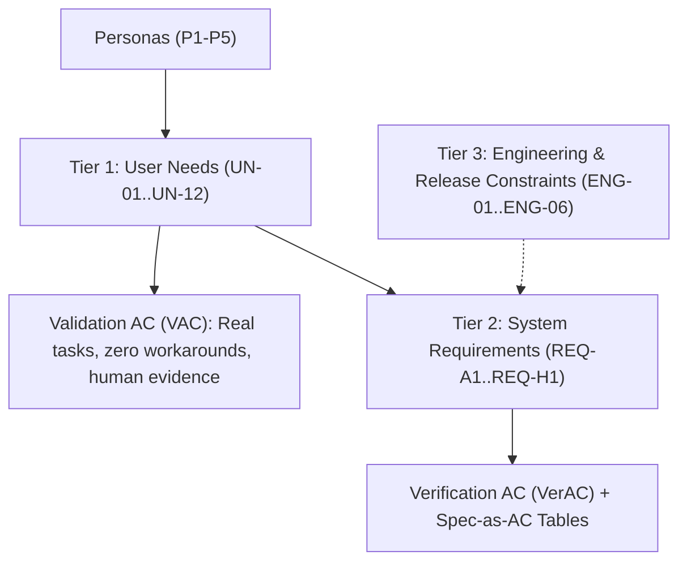

# Coral Requirements

Coral uses a 3-tier requirements architecture that separates **User Needs and
Validation** from **System Requirements and Verification** and **Engineering
and Release Constraints**. Detailed inventories, tables, and feature contracts
live in modular Specification-as-Acceptance-Criteria documents under
`dev/requirements/specs/` so requirements stay scannable and never accumulate
override sediment.

Historical `R-001`–`R-067` records through published 0.2.9 remain archived in
requirements-0.2.9-legacy.md; see the
[legacy crosswalk](requirements/crosswalk.md) for ID mappings.

## Architecture of the 3 Tiers

| Layer | Document | Question Answered | Evidence Type |
| --- | --- | --- | --- |
| Tier 1: User Needs | [User Needs](requirements/user-needs.md) | Did we build the right thing for real users? | Representative human task sessions, cold-reader checks, workaround audits (`VAC`) |
| Tier 2: System Requirements | [System Requirements](requirements/system-requirements.md) | Did we build the system right against formal contracts? | Deterministic unit, property, fuzz, E2E, benchmark, and packed-consumer tests (`VerAC`) |
| Tier 2 Spec-as-AC Modules | [Specs Index](#decomposed-specifications-as-acceptance-criteria) | What exact tables, standards, budgets, and boundaries apply? | Declarative specification tables directly verified by tests and audits |
| Tier 3: Engineering Constraints | [Engineering Constraints](requirements/engineering-constraints.md) | Does the build meet toolchain, compatibility, security, and governance bars? | CI gates, dependency integrity, coverage floors, HITL notation reviews (`ENG`) |

Schema versions remain independent of Coral package releases. Graph-only APIs
retain GraphIR 3 (`3.0.0`), saved-source portable successor APIs use `4.0.0`,
and saved-source editions (`0.2.8`, `0.2.9`) evolve under Language
Specification 1.3.0. Coordinating changes in `graph-ir` and `graph-ir-tools` is
supported whenever portable authored meaning benefits from an explicit IR
contract.

## Personas and Release-Gating Policy

Every User Need is anchored to a persona with an explicit release-gating class:

| ID | Persona | Gating Class | Job-to-Be-Done | Operating Context |
| --- | --- | --- | --- | --- |
| **P1** | Diagram Author | Primary (Release-Gating) | Create, refine, explain, and publish accurate technical diagrams maintained in version control. | Desktop Chrome, online-hosted web app, local files, realistic 20–100+ char labels, 5–50+ nodes, groups. |
| **P2** | Web & React Embedder | Primary (Release-Gating) | Render Coral source in plain HTML/docs pages or embed interactive editing in a React app. | Node.js >= 24.19.0, ESM/IIFE web pages (no React) or React 18.3/19 + `@xyflow/react` 12. |
| **P3** | Automation & Terminal Consumer | Primary (Release-Gating) | Validate, convert, lay out, and render diagrams headlessly via MCP, CLI, GraphIR, or plain text. | Headless Node/stdio (`coral-mcp`), GraphIR JSON pipelines, ASCII/MonoTrue terminals. |
| **P4** | Keyboard / Accessibility-First Author | **Secondary (Catch-Up Releases)** | Author, inspect, edit, and export diagrams without a pointer, with predictable focus and announcements. | Desktop Chrome keyboard-only sessions. Tracked continuously; **non-blocking outside dedicated accessibility catch-up releases**. |
| **P5** | Diagram Author Migrating to Coral | Primary (Release-Gating for active baseline; `Target` clauses non-blocking until target slice) | Migrate existing Mermaid, Graphviz/DOT, and PlantUML diagrams to Coral safely and verify fidelity. | Desktop Chrome (one-at-a-time interactive) and Command Line (batch migration with similarity scoring and side-by-side reports). |

## Tier 1 Summary: User Needs

Full definitions and Validation Acceptance Criteria live in
[user-needs.md](requirements/user-needs.md).

| ID | Persona | Gate Class | User Need Summary | Derived REQs |
| --- | --- | --- | --- | --- |
| [UN-01](requirements/user-needs.md#un-01-fast-first-diagram-and-honest-capability-discovery) | P1 | Primary | Start from faithful examples and see honest capability boundaries without an account. | `REQ-D1`, `REQ-H1` |
| [UN-02](requirements/user-needs.md#un-02-frictionless-text-first-authoring-and-lossless-round-tripping) | P1 | Primary | Author Coral text with exact source preservation, deterministic IDs, and actionable errors. | `REQ-A1`, `REQ-A2`, `REQ-A3`, `REQ-C1`, `REQ-F3` |
| [UN-03](requirements/user-needs.md#un-03-direct-visual-editing-that-preserves-authored-intent) | P1 | Primary | Edit diagrams visually with responsive gestures, full text parity, and clean Undo/Redo. | `REQ-A2`, `REQ-B4`, `REQ-C1`, `REQ-C2`, `REQ-G2` |
| [UN-04](requirements/user-needs.md#un-04-scannable-publication-ready-visual-legibility-and-layout-reliability) | P1 | Primary | Label elements descriptively across notations and directions with compact, aligned, collision-free output. | `REQ-B1`, `REQ-B2`, `REQ-B3`, `REQ-B4`, `REQ-B5`, `REQ-E1`, `REQ-E3` |
| [UN-05](requirements/user-needs.md#un-05-domain-accurate-notations-and-self-contained-custom-symbols) | P1 | Primary | Use domain-accurate notations and portable document-local custom SVG symbols. | `REQ-A1`, `REQ-B1`, `REQ-B3`, `REQ-B5`, `REQ-C2`, `REQ-D1`, `REQ-D2` |
| [UN-06](requirements/user-needs.md#un-06-non-destructive-diagram-migration-with-fidelity-and-similarity-reporting) | P5, P3 | Primary | Migrate Mermaid/DOT/PlantUML diagrams one-at-a-time or in CLI batches with loss and visual-similarity reports. | `REQ-D3`, `REQ-E3` |
| [UN-07](requirements/user-needs.md#un-07-local-document-ownership-crash-recovery-and-faithful-multi-format-export) | P1 | Primary | Keep local file ownership, recover unsaved drafts, and export faithful SVG/PNG/JPEG/HTML. | `REQ-A3`, `REQ-B1`, `REQ-B2`, `REQ-B4`, `REQ-B5`, `REQ-C1`, `REQ-D2`, `REQ-E1`, `REQ-E3` |
| [UN-08](requirements/user-needs.md#un-08-zero-framework-web-embedding-and-reusable-react-integration) | P2 | Primary | Embed standalone source-to-SVG rendering or React 18/19 editor components cleanly. | `REQ-A1`, `REQ-B2`, `REQ-F1`, `REQ-F2`, `REQ-F3`, `REQ-H1` |
| [UN-09](requirements/user-needs.md#un-09-scriptable-automation-mcp-tooling-and-portable-semantic-interchange) | P3 | Primary | Validate, convert, lay out, and render diagrams headlessly via MCP and GraphIR. | `REQ-A1`, `REQ-A2`, `REQ-A3`, `REQ-B2`, `REQ-B3`, `REQ-D3`, `REQ-E3`, `REQ-F2`, `REQ-F3`, `REQ-H1` |
| [UN-10](requirements/user-needs.md#un-10-readable-plain-text-and-terminal-diagramming) | P3, P1 | Primary | Produce readable ASCII and controlled MonoTrue diagrams for terminals, RFCs, and prompts. | `REQ-E2` |
| [UN-11](requirements/user-needs.md#un-11-private-opt-in-human-reviewed-on-device-ai-editing) | P1 | Primary (0.2.10 opt-in) | Opt into local browser AI editing with full consent, zero exfiltration, and human-reviewed Apply. | `REQ-G1`, `REQ-G2` |
| [UN-12](requirements/user-needs.md#un-12-complete-keyboard-operability-and-honest-accessibility-semantics) | P4 | **Catch-Up Release** | Operate authoring, review, and export flows via keyboard with clear focus and live status. | `REQ-C3`, `REQ-G2` |

## Tier 2 Summary: System Requirements

Full requirement statements and Verification Acceptance Criteria live in
[system-requirements.md](requirements/system-requirements.md).

| Domain | Requirements |
| --- | --- |
| A. Source Language, Identity & Persistence | [REQ-A1](requirements/system-requirements.md#req-a1-saved-source-authority-and-editioned-language-contract), [REQ-A2](requirements/system-requirements.md#req-a2-deterministic-identity-source-preserving-edits-and-fixpoint-round-trip), [REQ-A3](requirements/system-requirements.md#req-a3-located-diagnostics-draft-survival-and-local-recovery) |
| B. Visual Legibility, Layout & Routing | [REQ-B1](requirements/system-requirements.md#req-b1-independent-symbol-and-caption-geometry), [REQ-B2](requirements/system-requirements.md#req-b2-deterministic-text-measurement-and-cross-surface-scene-parity), [REQ-B3](requirements/system-requirements.md#req-b3-notation-aware-layout-and-generated-route-resilience), [REQ-B4](requirements/system-requirements.md#req-b4-authored-geometry-precedence-and-spatial-constraint-honesty), [REQ-B5](requirements/system-requirements.md#req-b5-diagram-rendering-aesthetics-alignment-and-connector-hygiene) |
| C. Interactive Editing, Parity & Accessibility | [REQ-C1](requirements/system-requirements.md#req-c1-bidirectional-source-canvas-inspector-parity-and-atomic-history), [REQ-C2](requirements/system-requirements.md#req-c2-precision-canvas-and-connection-gestures), [REQ-C3](requirements/system-requirements.md#req-c3-keyboard-operability-focus-management-and-accessible-semantics) *(Catch-Up)* |
| D. Notations, Custom Symbols & Migration | [REQ-D1](requirements/system-requirements.md#req-d1-bounded-visual-notations-and-specialized-sequence-semantics), [REQ-D2](requirements/system-requirements.md#req-d2-self-contained-document-local-user-symbols), [REQ-D3](requirements/system-requirements.md#req-d3-non-destructive-foreign-format-migration-and-loss-reporting) |
| E. Export, Character Output & GraphIR | [REQ-E1](requirements/system-requirements.md#req-e1-faithful-svg-raster-and-standalone-html-export), [REQ-E2](requirements/system-requirements.md#req-e2-character-output-portable-ascii-and-controlled-monotrue), [REQ-E3](requirements/system-requirements.md#req-e3-portable-graphir-interchange-and-coordinated-schema-evolution) |
| F. Embedding, Browser, MCP & Grammar | [REQ-F1](requirements/system-requirements.md#req-f1-standalone-zero-framework-browser-renderer), [REQ-F2](requirements/system-requirements.md#req-f2-composable-public-libraries-and-react-integration), [REQ-F3](requirements/system-requirements.md#req-f3-general-purpose-mcp-server-and-tree-sitter-grammar) |
| G. Opt-In On-Device AI Editing (0.2.10) | [REQ-G1](requirements/system-requirements.md#req-g1-explicit-opt-in-verified-local-weights-and-zero-exfiltration-privacy), [REQ-G2](requirements/system-requirements.md#req-g2-detached-staged-review-single-transaction-apply-and-resource-ceilings) |
| H. Product Boundary & Capability Truth | [REQ-H1](requirements/system-requirements.md#req-h1-general-purpose-boundary-and-evidence-backed-capability-truth) |

## Decomposed Specifications-as-Acceptance-Criteria

When acceptance criteria are best expressed as structured tables, standards
inventories, or numeric matrices, the declarative specification itself serves
as the normative acceptance criterion:

- [Supported Diagram Types](requirements/specs/supported-diagram-types.md) —
  diagram types, external standards/validators (ISO/IEC, Coral U1/U2), surface
  support, and explicit exceptions (`UN-01`, `UN-05`, `UN-10`, `REQ-D1`,
  `REQ-E2`).
- [Budgets and Ceilings](requirements/specs/budgets-and-ceilings.md) — layout,
  parse/print/SVG regression, interaction, browser bundle, coverage, visual
  sizing, and on-device memory thresholds (`REQ-A1`, `REQ-A2`, `REQ-B1`,
  `REQ-B3`, `REQ-C2`, `REQ-E1`, `REQ-F1`, `REQ-G1`, `REQ-G2`, `ENG-03`).
- [Independent Symbol and Caption Sizing](requirements/specs/independent-symbol-caption.md)
  — decomposed specification and `graph-ir` / `graph-ir-tools` coordination
  contract (`UN-04`, `REQ-B1`, `REQ-E3`).
- [Diagram Rendering Quality and Layout Aesthetics](requirements/specs/diagram-rendering-quality.md)
  — normative rules for node/glyph alignment, exhaustive 32-shape stencil
  classification, strict orthogonality, anti-sawtooth bend hygiene, connector
  spacing/exits, and direction-aware edge/endpoint label placement (`UN-04`,
  `REQ-B5`).
- [Migration and Format Conversion](requirements/specs/migration-conversion.md)
  — P5 single-diagram and CLI batch migration contract, loss accounting,
  structural and visual similarity scoring, external-renderer sandboxing, and
  side-by-side reporting (`UN-06`, `UN-09`, `REQ-D3`, `REQ-E3`).

## Tier 3 Summary: Engineering and Release Constraints

Governance, toolchain, compatibility, security, and HITL notation gates live in
[engineering-constraints.md](requirements/engineering-constraints.md)
(`ENG-01`–`ENG-06`).
