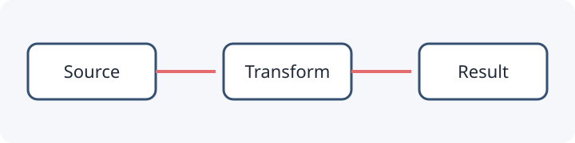

# Coral documentation

Create and share local-first diagrams, or choose the audience path that fits
your work.

The overview shows the same text-to-diagram flow used throughout Use Coral.

## Choose a path

- [Use Coral](use/index.md) to create, edit, convert, and export diagrams.
- [Embed Coral](embed/index.md) to choose packages and integrate Coral APIs.
- [Contribute to Coral](contribute/index.md) to track the contributor guide
  and repository workflows.

## Related

- [Use Coral](use/index.md)
- [Embed Coral](embed/index.md)
- [Contribute to Coral](contribute/index.md)
